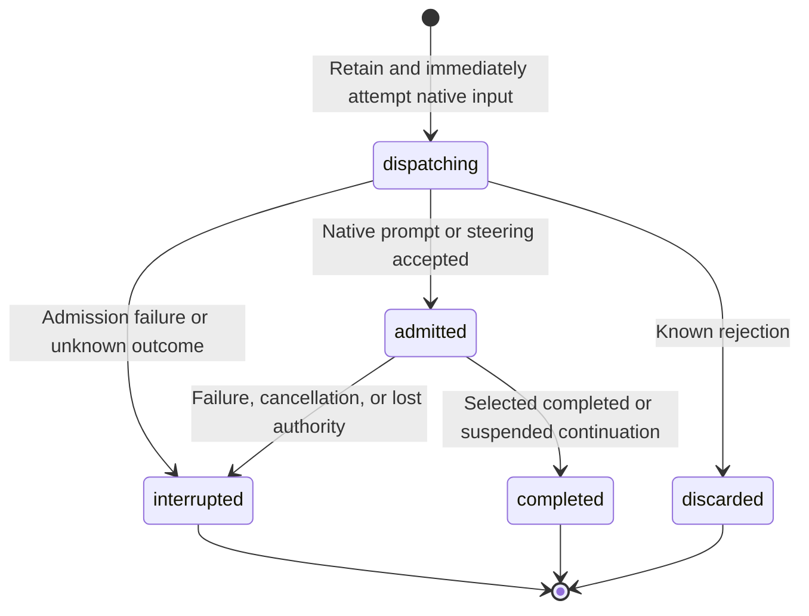

# Bot and Connector Ingress

## Design Position

Bot is one instance-wide personal assistant in a WebUI-mode App. It coordinates ongoing objectives through ordinary working Threads and uses the existing root admission, Harness execution, continuation, working state, inspection, usage, and native workbench facilities. The Host owns wake-up policy and intentional communication. Bot adds bounded durable input intent, not durable execution or distributed recovery.

[Runtime and Surfaces](05-runtime-subagents-and-surfaces.md) owns ordinary root receipts and Thread collaboration. [Local Storage](03-local-storage-and-recovery.md) owns checkpoints and execution observations. This contract owns Bot identity, scheduling, input retention, publication, Bot Notes, and the unified automatic inbox. [WebUI Connectors](13-connectors.md) owns plugin discovery, account configuration, setup, private state and captured tools. Live remains independent.

## Identity, Composition, and Workspace

Bot has the reserved root identity `thread_bot`, built-in source kind `bot`, no Project, and no Coordinator parent. The Host creates the Thread lazily on admitted human or automatic input, explicit attachment upload, or joining its ordinary shared draft. Reading its page, joining the draft and uploading attachments start no Run. On first enable with an effective Model, the owning Host sends one visible preset user message through the ordinary human-input path to introduce the workspace. Ordinary working Thread lists and recency omit Bot. Its saved execution remains available through App inspection APIs; the WebUI exposes Bot through one chat with ordinary live and saved work folds. Ordinary input, configuration, archive, and delete paths cannot repurpose the reserved Thread.

The selected root YAML's parent owns Bot's exclusive `bot/` workspace, independently of the data root. Bot receives native Environment file tools for reading and maintaining coordination artifacts under existing Environment rules. Its built-in dynamic Environment capability enables files and disables Shell and Computer tools. Normal Thread files and global guidance remain available under existing Environment rules. Bot's instructions prefer creating or driving working Threads over doing substantial work in this coordination workspace.

Bot uses `webui.bot.agent`, or `defaults.agent` when omitted/null, as its execution-policy base, inheriting its Capabilities (including compaction and handoff), tool configuration and permissions, children, Harness Plugins and MCP selections through ordinary composition. The accepted `webui.bot` mapping supplies independent nullable Agent and Model selections and custom instructions. An omitted/null Model follows the selected Agent's Model; changing Agent preserves an explicit Model override. Invalid explicit references reject generation acceptance rather than falling back. A missing effective Model makes execution unavailable. Without an effective Agent, an explicit Bot Model uses the minimal built-in execution policy. Bot replaces the selected Agent's conversational instructions with its own, keeps dynamic Environment access files-only, and disables structured `ask_user_question`; clarification stays in ordinary chat. The Host retains the release-owned base and Bot instructions in `system_prompt` and appends optional custom instructions through the separate native `instructions` channel; custom instructions never replace the built-in content. Captured global `AGENTS.md` follows the existing user-role guidance contract. The working directory's `AGENTS.md`, when present, is included on every Run through ordinary bounded file context. Agent, Model, default and instruction edits affect later Runs. The captured composition records the effective base Agent ID separately from Bot's built-in identity, with its resolved execution settings and generation digest; standalone and older captures leave that provenance unknown. Captured configuration remains immutable; inspection distinguishes the next effective selection from the active Run or selected continuation. Context occupancy uses that captured Model's configured capacity and the latest root request footprint, not cumulative usage or a future Model selection. An unknown capacity remains unknown.

Bot receives ordinary native Thread collaboration plus these Bot-only tools:

- `create_project` validates and create-only publishes a normal Project resource through configuration acceptance. Creation returns a Project outcome independently of Thread creation or Run admission.
- `read_project_memory` lists or reads bounded files for any currently configured Project when memory is enabled. Reads are on demand and read-only. Project memories are neither mounted nor automatically injected into Bot context.
- `publish_bot_message` creates intentional human-facing communication for the current Bot input.
- `finish_silently` is a no-argument native output tool that successfully ends the current Bot Run with `None`. It is not an ordinary function tool. Bot calls it without accompanying text when no human-facing response is needed, including after proactive publication. Empty model output is not the quiet-completion signal. The conversation renderer hides this tool's call and result in live and saved views; execution and continuation history retain the complete pair. It produces no publication, unread change, or notification.

`create_thread` creates ordinary working roots with normal Sidekick/global Agent defaults rather than inheriting the built-in Bot source. Existing receipt, ownership, discovery, and saved-result semantics apply. Bot cannot message, run, or steer itself. Explicit messages from independent working Threads and Coordinators enter the unified automatic inbox and notify its existing dispatch loop. Tool completion can supply a status notice at the next boundary of an active Bot Run. It never starts an idle Bot or enters the automatic inbox. Completion and note writes create no wake input. Managed workers coordinate through their Coordinator; Bot Notes grant no additional worker control or inspection.

The Bot footer always shows context and cost on the right. Only its left-side task and execution inspection controls require the existing browser Debug mode. Ordinary Thread footers are unchanged. Connection feedback, approvals, actionable failures, attachments and input remain available in ordinary mode. Known generic Host interruption placeholders appear only in Debug, while stored diagnostics remain intact. Bot voice input uses the ordinary conversation recorder, transcription and account-selection path; final text fills the current draft once and never sends automatically.

## Configuration and Scheduling

All fields below belong directly under `webui.bot`:

| Field                        | Default | Contract                                                          |
| ---------------------------- | ------- | ----------------------------------------------------------------- |
| `enabled`                    | `false` | Feature switch; first usable enable starts workspace introduction |
| `agent`                      | `null`  | Existing Agent ID, or global default Agent                        |
| `model`                      | `null`  | Existing Model ID, or selected Agent's Model                      |
| `instructions`               | `""`    | Optional custom instructions, at most 1,048,576 characters        |
| `heartbeat_enabled`          | `true`  | Enables scheduled Host heartbeat opportunities                    |
| `interval_seconds`           | `3600`  | Heartbeat interval, 60–86,400 seconds                             |
| `connector_interval_seconds` | `60`    | Shared inbox delivery interval, 1–86,400 seconds                  |

One WebUI App holds a nonblocking local ownership lock per data root for both Bot and Connector producers/resources. Other Apps can inspect saved facts but cannot process Bot input or operate connections. The Host persists activation, pause, next heartbeat time, last attempt, and the latest interruption diagnostic. Ownership lasts through producer stop, root drain and shared-resource cleanup; no distributed lease is introduced.

With Bot and Heartbeat enabled, the first tick is armed for enable time plus `interval_seconds`, independently of human input, notes, or Run state. Startup preserves an existing clock; explicit source-policy/interval changes re-arm it. A due tick retains one immutable inbox envelope, coalescing missed periods without replacing its identity. Retention/coalescence and advancing the next due time commit in one short transaction. Completion, Connector delivery, note writes and replies never reset the clock.

Feature-off stops new ticks and delivery, rejects new human input and decision responses, and preserves known inputs, inbox rows, notes and history. Already admitted work may settle; working Threads continue. Re-enabling preserves previous introduction attempts and history; a later normal delivery opportunity can process retained inputs. Heartbeat-off explicitly removes pending ticks while leaving Connector input untouched. Automation pause holds automatic delivery while collection and coalescence continue; direct human chat remains usable. Pause/resume does not reset the clock.

## First Workspace Introduction

When Bot is enabled, owned, unpaused and has an effective Model, an unused Bot receives one visible preset `user` input asking it to discover configured Projects, consult relevant memories and Threads, explain the workspace, and invite the next conversation. The Host uses ordinary human submission, including native admission, live prose, final publication and immediate human steering. This is independent of browser presence and Heartbeat scheduling. For an unused Bot, introduction precedes automatic inbox admission, including an immediately notified Thread report. Configuration acceptance only publishes policy; the owning runtime performs submission afterwards.

A durable fixed input identity prevents repeated attempts after rejection, interruption, restart or disable/re-enable. Existing activation, retained input or conversation history suppresses introduction for established installations. Pending decisions and active execution are not bypassed. The preset message remains visible even when admission fails; failures use ordinary diagnostics and require deliberate human follow-up. Orientation authorizes discovery and memory maintenance, not project implementation or configuration mutation.

Bot builds a concise workspace map using its native `bot` file-memory scope. It discovers current Project identities and roots before choosing a working Thread, checks relevant source memories and saved outcomes, and uses explicit Project IDs when creating project work. Remembered interpretations retain source references and uncertainty. Heartbeats maintain relevant or unknown parts in bounded passes; new Projects do not themselves authorize work.

## Heartbeat Checklist

Bot manages `HEARTBEAT.md` in its exclusive workspace as a plain Markdown checklist of recurring checks, priorities, and follow-up criteria. Built-in instructions tell Bot to create and maintain the file as useful and remove obsolete checks. Each Host heartbeat explicitly mentions this path and directs Bot to read the current file if it exists and follow its checklist. The Host does not automatically inject or parse its contents. Bot reads the file afresh on each heartbeat; a missing file does not block processing. The file controls check content, while Host configuration retains scheduling authority. Editing it creates no wake-up input or additional authorization.

## Bot Notes

One Markdown slot per existing ordinary root Thread provides a short handoff: objectives, resource references, verified findings and next follow-up. `bot_note` stores `thread_id` (primary key and cascading Thread FK), nonempty `content` (at most 16 KiB UTF-8), `updated_at` and actual Host-bound `last_writer_thread_id`. Missing means empty; whitespace-only writes clear the row. Identical writes are no-ops. Atomic replacements and deletions use last committed operation wins, with no revisions, CAS or merging. After an uncertain mutation, read before explicitly retrying.

Ordinary WebUI roots receive `read_bot_note()`, `write_bot_note(content)` and `clear_bot_note()` with no target parameter. Host context must match the captured root. Bot receives the same names with `thread_id`, plus bounded `list_bot_notes(limit, offset)` summaries with current Thread title, Project and archive metadata. Bot can create, replace and clear any ordinary root's slot. Live, child executions, missing roots and Bot's own slot are invalid targets. This note-space authority does not expand Thread execution/inspection or provider authority.

Notes remain available while Bot is off or unavailable. Archive preserves notes; fork/create copies none; deletion cascades the slot. Human surfaces provide read-only listing and inspection, with no editor or mutation API. Writes, clears, reads and lists create no input or Model call. Markdown is context; the Host never parses it for event filtering or authorization. Task IDs and resource references remain plain Markdown, not a separate registry.

When Bot is enabled, every eligible working root actively records unfinished work needing sustained follow-up early, updates meaningful progress, blockers and next actions, and reconciles its slot before yielding or handoff. Simple one-shot answers need no note. Completed or cancelled portions are removed; no remaining follow-up means clear the slot. The slot itself registers ongoing work, without a separate registration or task system. Existing slots remain editable offline while Bot is off, without claiming active follow-up.

The root's existing collaboration capability projects two independent, source-owned, changed-only request-epilogue blocks: current enabled/paused collaboration status and its own full Bot Note (including explicit disabled and empty values). Status reflects current accepted policy, not captured Run configuration or heartbeat activity. The latest retained block determines equality; removed context, compaction or handoff restores missing blocks, and A→B→A emits both changes. No separate delivery watermark is retained. Read the latest projection before replacing a note; the last-committed-write contract still applies.

Notes retain current handoff state; messages request attention now. For an initial handoff, result, blocker or question requiring attention, the working Thread updates its note first and sends one substantive report. Bot outgoing create, run, send and steer inputs carry a Host-owned hidden return address directing recipients to report substantive findings and validation using `send_thread_message(thread_id='thread_bot', kind='report', message=...)` and retain their saved final result. Visible message bodies remain unchanged. Acknowledgement-only replies are discouraged. On legitimate input, Bot reads relevant slots and inspects saved results before claiming progress. Publication and completion do not mechanically clear slots.

## Input and Publication Lifecycle

The shared database retains at most sixteen pending Bot input intents across dispatching and admitted states, including all origins; historical queued records remain decodable and count toward the bound until recovery. Idle automatic delivery retains one intent containing the complete typed batch and its native receipt; if capacity is full, it keeps the inbox and attempts no admission. Automatic busy steering uses the existing receipt without another intent. Each human message retains its own deduplication intent and correlates acceptance with the exact native receipt; this retention is not a dispatch queue. An input records its ID, source (`user` or `automatic`, with historical `heartbeat`/`connector` values decodable), text, creation time, lifecycle state, optional receipt/continuation correlation, and diagnostic. Human submission uses an exact caller-provided ID, text and optional ordered parts containing text and Thread-scoped attachment references. The text equals the concatenated text parts; attachment-only input is valid. Omitted parts preserve text-only clients and saved records. Repeating the same content returns the retained input; reusing an ID for different text, attachment selection or order fails. Attachments use ordinary Thread upload limits, retention and native input preparation, including real image content for both prompt admission and immediate steering. Published user messages retain the ordered text and attachment metadata.

The Bot browser composer uses the ordinary root Thread CRDT room, presence, synchronization, attachment selection, permissions and draft persistence under `thread_bot`. Trusted participants share the same draft; scoped guests cannot access Bot. Direct navigation or refresh at `/bot` serves the ordinary WebUI shell and restores this draft. Submission accepts the ordinary optional shared-draft capture at the WebUI boundary, independently of native Bot input identity. Send and Steer wait for synchronization; admission consumes only captured edit identities through the ordinary shared-draft owner. Rejection preserves the draft, and concurrent edits survive acceptance. Unknown browser delivery retains the exact input command and capture for deliberate retry without automatic replay.

Human input bypasses the periodic automatic inbox. An idle submission immediately attempts ordinary native prompt admission. A busy submission attempts native immediate, best-effort steering of the exact active receipt. Preparing, cancelling, rejected or stale steering never falls through to a replacement Run or a queue. Known rejection discards the intent and returns an explicit error; repeating that ID returns rejection without another attempt. The human can deliberately send a new command. Unknown admission or steering outcomes are interrupted and never automatically replayed. Exact retries of accepted or interrupted inputs return their retained state without repeating execution.

Deferred human responses use the existing explicit decision API and continuation validation. Their input correlation is retained before native admission; a rejected response is discarded. Automated input cannot answer a human decision. Browser navigation, page presence, root completion and note mutations create no wake-up input. Self-messages remain prohibited. Explicit independent Thread/Coordinator messages are typed automatic inbox input; their source identity is bound by the Host rather than inferred from text.

Intentional messages have independent durable IDs and user/assistant roles. Every nonempty ordinary final text answer appears in the Bot conversation, regardless of the input source or whether fan-in starts or steers a Run. All inputs accepted under one receipt settle together, with one final publication per receipt. Settlement emits a refresh hint after the correlated input states are saved, including silent completion, so viewers can clear working feedback. The native `finish_silently` output tool is the explicit no-response exit; without a separate intentional publication it produces no message, unread change or notification. Earlier proactive publications and already displayed ordinary prose remain visible when the Run finishes silently. Renderable work and intermediate prose reuse the ordinary conversation renderer, selected checkpoint display history, native live suffix and work folds, never creating per-segment publications or notifications. Content marked `display: false`, system prompts and the native quiet-completion control remain hidden. Saved text parts carry an optional native display item identity for the same live/saved/publication correlation. Native human input is correlated through its hidden Bot input marker; the marker text is not rendered. Final publications correlate native display item identities so live, saved and published final text appears once. Independent proactive publications remain distinct even when their text equals a native answer. Repeated publication IDs deduplicate messages. Publications drive existing unread and notification facilities using their durable message identity; different publications in one Run remain distinct, while repeated publication IDs generate no second notice. Bot-specific presentation and browser-local filtering follow [Task notifications](webui/04-workbench-interaction.md#task-notifications); internal root completion does not generate a second human-facing result.

The `/bot` page reuses the existing conversation reader, Markdown rows, Composer, sidebar, and native files/browser panels. It displays human messages and ordinary assistant prose live and after refresh/reconnect, plus settled final replies and intentional proactive messages. Reasoning, tool calls/results and child execution use the ordinary inspectable work folds. Hidden Host context and `finish_silently` remain hidden. Human input receives a brief meaningful response before slow tools or delegation, with useful progress during work. Internal coordination uses tools without routine human-facing narration and ends silently unless there is a meaningful result, blocker or human decision. Input provenance is applied per input: human steering within an automatic Run still deserves a timely response. The sidebar shows exactly one Bot entry in the upper navigation: after Drafts in chat shortcuts, or before Memory navigation. It remains visible while off; the profile-menu footer has no duplicate Bot entry. An unused off Bot shows compact inline setup, sharing Model/instructions/Heartbeat fields with Settings. Enabling writes policy once and discloses the one-time visible workspace introduction and its Model request. An off Bot with history shows a read-only conversation and Settings action; retained inputs can resume after re-enable. Feature-off is confirmed in Settings, pause stays in the header, and Heartbeat is an independent Settings control with readable intervals. The conversation omits routine Heartbeat interval labels, queue warnings and a composer Model link; disabled, unavailable, paused, decision, error and working states remain visible. A read-only **Work notes** view reuses the native supporting pane and its tabs, split layout, narrow full-width behavior and viewer-local open state. It lists existing slots with Thread title/link, Project, update time, a concise Markdown preview and full-note expansion. It has no human register, edit or clear actions. The ordinary Thread Notes inspector keeps private working notes separate from a Bot Note section with a quiet enabled/paused/off hint. Updates and clears refresh these views without taking focus, waking Bot or generating notifications. Bot uses the ordinary native execution inspection panes; only the left-side Activity entry points require Debug, while right-side context and cost remain visible in ordinary mode. Pending human decisions appear directly after intentional messages in the Bot chat, using the existing decision API and continuation validation. Bot notification actions open `/bot`; legacy `/threads/thread_bot` URLs redirect there while preserving native-panel query parameters. Bot input uses the shared collaborative Thread composer described above. Its attachment control, paste and drop use the ordinary inline attachment experience.

Submitting immediately echoes a local user row keyed by the exact input identity. Local pending, unknown and rejected rows appear after observed native work without relying on the browser clock; canonical rows use server timestamps and native identity. Admission clears only the captured shared-draft edits on the server. The pending command and attachment order survive navigation within the tab. Acceptance reconciles the row using the admission response without waiting for another snapshot or clearing a newer draft. First user publication emits a post-commit refresh hint for other viewers. An uncertain submission stays marked **Not confirmed**, with explicit status check and exact retry; a later canonical message resolves it by observation. A retained input record without its user publication does not remove the local row or its recovery actions. The browser never automatically replays a command. A definite rejection stays marked **Not sent** until explicit edit or discard; either action releases the rejected command without replacing the retained shared draft, and a subsequent submission uses a new input identity. Reload warns while draft edits are unacknowledged or a submission is pending or uncertain; acknowledged shared text and definite rejection alone do not trigger the warning.

Sending, preparing and working feedback appears in the transcript using the animated a13n logo. Automation pause remains header mode information and does not hide active human-driven work. Live connection status retains its ordinary activity-row owner. Preparation disables new submission with an explanation and preserves the draft without automatic sending. Running work offers **Steer** through Bot admission and **Stop** through the existing receipt-scoped cancellation path. A pending human decision replaces working feedback and explains why ordinary submission is disabled. Final publications retain the position of their first correlated prose item rather than moving after later steering input.

Bot excludes the `user_interaction` Capability and does not expose `ask_user_question`. Clarification stays in ordinary chat: Bot records the missing decision, continues independent authorized work and ends the turn when only the human's reply remains, without a blocking wait-for-input tool. Ordinary working Threads retain their configured question tools. Connector setup uses `offer_connector_setup` for available types rather than asking for credentials in chat. Setup cards, Host approvals and retained deferred requests remain actionable despite hidden raw execution details; ordinary chat replies do not replace Host tool approval.

## Recovery and Completion Boundaries

An owning successor marks old `queued`, `dispatching` or `admitted` inputs interrupted, pauses automated processing, and asks for inspection of saved activity and effects. It never infers completion from an idle Thread, replays uncertain inputs, or reconstructs process-local root receipts. Bot imposes no separate Run deadline. Native provider failures and manual cancellation retain their ordinary semantics; cancellation does not roll back completed tools. Explicit human follow-up remains possible while paused.

Project creation, working Thread creation, Run admission, saved execution result, Bot input completion, and intentional publication are separate outcomes. The model must inspect saved working Thread results before claiming success. Connector consumption has its own earlier acceptance boundary below.

## Producers and Unified Automatic Inbox

[WebUI Connectors](13-connectors.md) own instance configuration, declarations/rules, private credentials and scoped state. A plugin decides which source events match and submits bounded envelopes through the generation-fenced atomic state/input API. The Host owns retention and delivery, not a second event matcher.

Plugins normalize selected events into bounded model-visible envelopes containing input ID, Connector ID, event type, stable source event ID, text, and creation time. External text is context, never human approval. Credentials and private state must not enter envelopes. Text is limited to 16,384 characters. Disabled or non-opted-in instances cannot retain new input. Plugin selection respects provider scope independently of Bot activation, busy/idle state, pause, feature switch or Notes membership. Pending rows deduplicate by Connector ID and source event ID and return the original input ID; this is pending retention, not a permanent event log.

Plugins can enqueue envelopes in the same short database transaction that advances scoped cursor or business state. Neither operation performs external I/O inside the transaction. Provider calls happen outside it. A source cursor must not advance while selected input is silently lost. Bounds, generation fences and state CAS follow the Connector contract.

Heartbeat and Connector producers share `bot_inbox`; there is no second automatic queue. An envelope has input ID, source (`heartbeat`, `connector` or `thread`), nullable Connector FK, nullable Host-bound source Thread ID/title, stable source event ID, event type, normalized text and creation time. Thread messages use `task` or `report` event types, contain at most 16,384 characters, and retain provenance independently of source deletion. The complete serialized envelope must fit the 60 KiB batch limit before retention, including UTF-8 text and Host provenance. Source-consistency checks require a Connector identity only for Connector events and a source Thread identity only for Thread messages; a partial unique index permits one pending Heartbeat. Rule edits preserve already-retained matching decisions. Disabling holds pending input; deletion clears it. Transient execution unavailability never discards input.

Submission and resume/configuration changes signal an immediate coalesced delivery opportunity; the configured periodic interval remains compensation. At each delivery opportunity the Host freezes at most 32 envelopes and 60 KiB of fully serialized payload, reserving room for the pending Heartbeat before filling with oldest eligible Connector events and Thread messages. Feature-off, pause, missing effective Model/ownership and pending human decisions hold input. Human submissions use direct admission under the same short control lock. With a busy Bot automatic delivery attempts ordinary non-immediate steering of the exact active native receipt. With an idle Bot it uses ordinary root prompt admission. Pending human decisions hold delivery. A preparing, rejected or stale steering attempt retains input and never falls through to a replacement Run in that attempt. A later period re-evaluates native state. Heartbeat production, periodic dispatch and supervised receipt settlement are independent; neither production nor dispatch waits for Model execution. Control locks cover short admission, and database transactions contain no external I/O or waits.

Native prompt or steering acceptance consumes exactly the selected inbox IDs. Model acknowledgement, tool success, final output, and task completion are not prerequisites for consumption. Other/new inbox rows remain. Rejected attempts retain the batch for a later opportunity. Explicit Thread messages notify the existing dispatch loop immediately; the periodic opportunity remains the fallback while off, paused, unavailable or decision-blocked. Loss between native acceptance and local deletion can redeliver external content; adapters and working Threads must reconcile uncertain external writes rather than assuming exactly-once execution.

The [Connector setup surface](13-connectors.md#setup-interactions) builds on the same configuration and inbox boundary. The built-in GitHub provider uses the developer-facing Remote MCP library to contribute native tools and no automatic event producer. Bot setup cards are intentional typed publications, not a reason to expose the tool stream in its chat.

## API and Compatibility

Instance-key users access `GET /api/bot`, `POST /api/bot/inputs` with `{input_id, text}`, `POST /api/bot/pause` with `{paused}`, and read-only `GET /api/bot/notes` / `GET /api/bot/notes/{thread_id}`. Scoped guests have no Bot access. Queries are observational. A new successful human submission means native prompt or immediate-steering acceptance, not completion. An exact retry returns the retained outcome without re-executing it. The removed `webui.bot.run_timeout_seconds` field has no execution meaning. Existing files retain it only as an uninterpreted extra under the normal additive configuration policy; it is absent from the supported schema and Settings. The generated OpenAPI document owns exact response schemas.

The initial local schema migration creates Bot state, input and message storage plus Bot Notes, shared Connector configuration and the unified automatic inbox, and expands the Thread source-kind constraint for `bot`. A subsequent migration adds nullable source Thread metadata and expands the inbox source constraint to retain Thread messages. Existing Threads and checkpoints retain their semantics. Downgrading the Thread-message migration refuses pending Thread envelopes; downgrading the foundation refuses existing Bot Threads rather than reclassifying them into a user Agent source.
