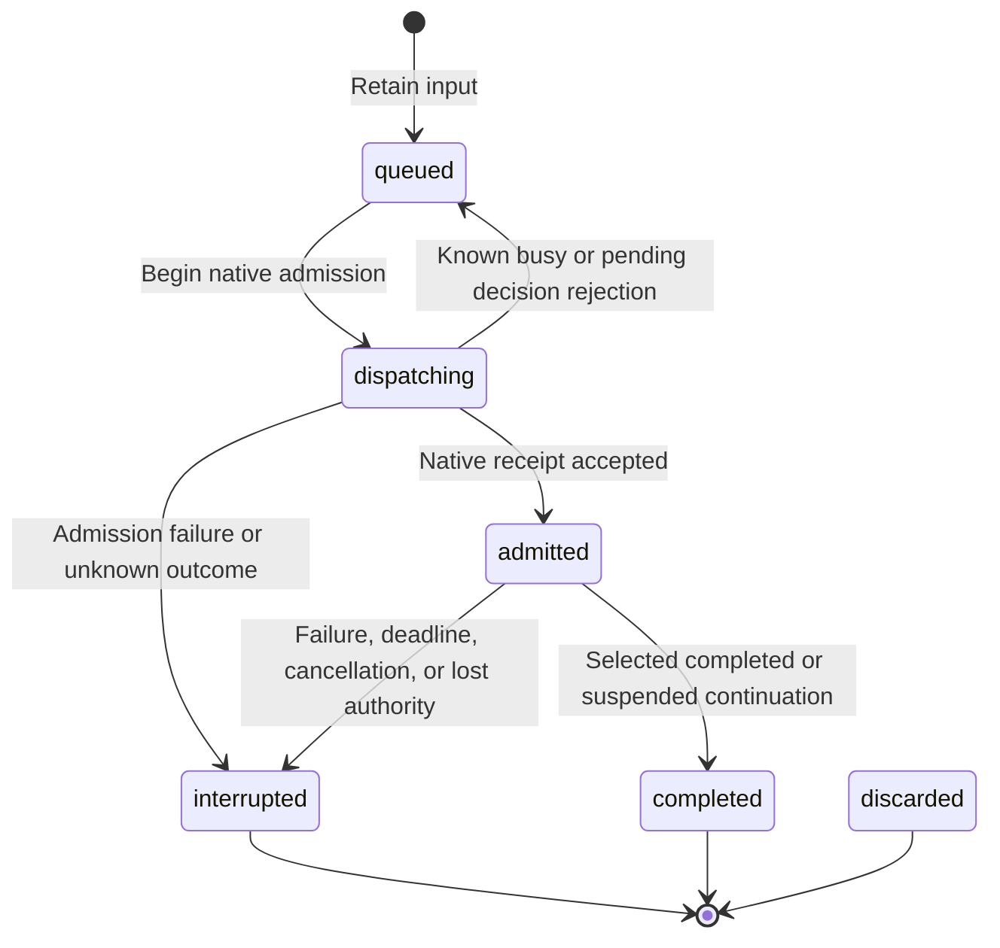

# Bot and Connector Ingress

## Design Position

Bot is one instance-wide personal assistant in a WebUI-mode App. It coordinates ongoing objectives through ordinary working Threads and uses the existing root admission, Harness execution, continuation, working state, inspection, usage, and native workbench facilities. The Host owns wake-up policy and intentional communication. Bot adds bounded durable input intent, not durable execution or distributed recovery.

[Runtime and Surfaces](05-runtime-subagents-and-surfaces.md) owns ordinary root receipts and Thread collaboration. [Local Storage](03-local-storage-and-recovery.md) owns checkpoints and execution observations. This contract owns Bot identity, scheduling, input retention, publication, Bot Notes, and the unified automatic inbox. Live remains independent.

## Identity, Composition, and Workspace

Bot has the reserved root identity `thread_bot`, built-in source kind `bot`, no Project, and no Coordinator parent. The Host creates the Thread lazily on admitted human or automatic input. Reading its page or saving configuration starts no Run. Ordinary working Thread lists and recency omit Bot; direct inspection remains available. Ordinary input, configuration, archive, and delete paths cannot repurpose the reserved Thread.

The selected root YAML's parent owns Bot's exclusive `bot/` workspace, independently of the data root. Bot receives native Environment file tools for reading and maintaining coordination artifacts under existing Environment rules. Its built-in dynamic Environment capability enables files and disables Shell and Computer tools. Normal Thread files and global guidance remain available under existing Environment rules. Bot's instructions prefer creating or driving working Threads over doing substantial work in this coordination workspace.

The accepted `webui.bot` mapping selects a Model and optional custom instructions, never a configured Agent. An omitted/null Model follows only the Model of `defaults.agent`; a missing effective Model makes execution unavailable. Configured Agent instructions, children, Harness Plugins, and MCP selections are not inherited. The Host retains the release-owned base and Bot instructions in `system_prompt` and appends optional custom instructions through the separate native `instructions` channel; custom instructions never replace the built-in content. Captured global `AGENTS.md` follows the existing user-role guidance contract. The working directory's `AGENTS.md`, when present, is included on every Run through ordinary bounded file context. Model and instruction edits affect later Runs.

Bot receives ordinary native Thread collaboration plus these Bot-only tools:

- `create_project` validates and create-only publishes a normal Project resource through configuration acceptance. Creation returns a Project outcome independently of Thread creation or Run admission.
- `read_project_memory` lists or reads bounded files for any currently configured Project when memory is enabled. Reads are on demand and read-only. Project memories are neither mounted nor automatically injected into Bot context.
- `publish_bot_message` creates intentional human-facing communication for the current Bot input.
- `finish_silently` is a no-argument native output tool that successfully ends the current Bot Run with `None`. It is not an ordinary function tool. Bot calls it without accompanying text when no human-facing response is needed, including after proactive publication. Empty model output is not the quiet-completion signal. The conversation renderer hides this tool's call and result in live and saved views; execution and continuation history retain the complete pair. It produces no publication, unread change, or notification.

`create_thread` creates ordinary working roots with normal Sidekick/global Agent defaults rather than inheriting the built-in Bot source. Existing receipt, ownership, discovery, and saved-result semantics apply. Bot cannot message, run, or steer itself. Worker messages and completion do not wake Bot.

## Configuration and Scheduling

All fields below belong directly under `webui.bot`:

| Field                        | Default | Contract                                                   |
| ---------------------------- | ------- | ---------------------------------------------------------- |
| `enabled`                    | `false` | Feature switch; saving it submits no prompt                |
| `model`                      | `null`  | Existing Model ID, or global default Agent's Model only    |
| `instructions`               | `""`    | Optional custom instructions, at most 1,048,576 characters |
| `heartbeat_enabled`          | `true`  | Enables scheduled Host heartbeat opportunities             |
| `interval_seconds`           | `3600`  | Heartbeat interval, 60–86,400 seconds                      |
| `connector_interval_seconds` | `60`    | Shared inbox delivery interval, 1–86,400 seconds           |
| `run_timeout_seconds`        | `180`   | Wait deadline for an admitted Bot input, 10–3,600 seconds  |

One WebUI App holds a nonblocking local ownership lock per data root. Other Apps can inspect saved facts but cannot process Bot input. The Host persists activation, pause, next heartbeat time, last attempt, and the latest interruption diagnostic. Shutdown relinquishes ownership; no distributed lease is introduced.

With Bot and Heartbeat enabled, the first tick is armed for enable time plus `interval_seconds`, independently of human input, notes, or Run state. Startup preserves an existing clock; explicit source-policy/interval changes re-arm it. A due tick retains one immutable inbox envelope, coalescing missed periods without replacing its identity. Retention/coalescence and advancing the next due time commit in one short transaction. Completion, Connector delivery, note writes and replies never reset the clock.

Feature-off stops new ticks and delivery, rejects new human input and decision responses, and preserves known inputs, inbox rows, notes and history. Already admitted work may settle; working Threads continue. Re-enabling saves/arms scheduling without a prompt; a later normal delivery opportunity can process retained inputs. Heartbeat-off explicitly removes pending ticks while leaving Connector input untouched. Automation pause holds automatic delivery while collection and coalescence continue; direct human chat remains usable. Pause/resume does not reset the clock.

## Heartbeat Checklist

Bot manages `HEARTBEAT.md` in its exclusive workspace as a plain Markdown checklist of recurring checks, priorities, and follow-up criteria. Built-in instructions tell Bot to create and maintain the file as useful and remove obsolete checks. Each Host heartbeat explicitly mentions this path and directs Bot to read the current file if it exists and follow its checklist. The Host does not automatically inject or parse its contents. Bot reads the file afresh on each heartbeat; a missing file does not block processing. The file controls check content, while Host configuration retains scheduling authority. Editing it creates no wake-up input or additional authorization.

## Bot Notes

One Markdown slot per existing ordinary root Thread provides a short handoff: objectives, resource references, verified findings and next follow-up. `bot_note` stores `thread_id` (primary key and cascading Thread FK), nonempty `content` (at most 16 KiB UTF-8), `updated_at` and actual Host-bound `last_writer_thread_id`. Missing means empty; whitespace-only writes clear the row. Identical writes are no-ops. Atomic replacements and deletions use last committed operation wins, with no revisions, CAS or merging. After an uncertain mutation, read before explicitly retrying.

Ordinary WebUI roots receive `read_bot_note()`, `write_bot_note(content)` and `clear_bot_note()` with no target parameter. Host context must match the captured root. Bot receives the same names with `thread_id`, plus bounded `list_bot_notes(limit, offset)` summaries with current Thread title, Project and archive metadata. Bot can create, replace and clear any ordinary root's slot. Live, child executions, missing roots and Bot's own slot are invalid targets. This note-space authority does not expand Thread execution/inspection or provider authority.

Notes remain available while Bot is off or unavailable. Archive preserves notes; fork/create copies none; deletion cascades the slot. There is no human Notes editor or HTTP CRUD. Writes, clears, reads and lists create no input or Model call. Markdown is context; the Host never parses it for event filtering or authorization. Task IDs and resource references remain plain Markdown, not a separate registry.

On legitimate input, Bot lists/reads relevant slots, inspects saved working Thread results, follows up through existing tools, creates or updates slots when useful, and clears handled follow-ups or retains concise next steps. Publication and Run completion do not clear slots automatically.

## Input and Publication Lifecycle

The shared database retains at most sixteen pending Bot input intents across queued, dispatching and admitted states, including all origins. Idle automatic delivery retains one intent containing the complete typed batch and its native receipt; if capacity is full, it keeps the inbox and attempts no admission. Busy steering uses the existing receipt without another intent. An input records its ID, source (`user` or `automatic`, with historical `heartbeat`/`connector` values decodable), text, creation time, lifecycle state, optional receipt/continuation correlation, and diagnostic. Human submission uses an exact caller-provided ID and text. Repeating the same pair returns the retained input; reusing an ID for different content fails.

Deferred human responses use the existing explicit decision API and continuation validation. Their input correlation is retained before native admission; a rejected response is discarded. Automated input cannot answer a human decision. Browser navigation, page presence, root completion, self-messages, and worker reports create no wake-up input.

Intentional messages have independent durable IDs and user/assistant roles. Human input and its ordinary final answer appear in the Bot conversation. Heartbeat and Connector final output stay in Activity unless Bot explicitly publishes a useful result, blocker, or question. Repeated publication IDs deduplicate messages. Publications drive existing unread and notification facilities using their durable message identity; different publications in one Run remain distinct, while repeated publication IDs generate no second notice. Bot-specific presentation and browser-local filtering follow [Task notifications](webui/04-workbench-interaction.md#task-notifications); internal root completion does not generate a second human-facing result.

The `/bot` page reuses the existing conversation reader, Markdown rows, Composer, sidebar, and native files/browser panels. It displays intentional messages. The Bot sidebar entry sits directly above the profile menu and remains visible while off. An unused off Bot shows compact inline setup, sharing Model/instructions/Heartbeat fields with Settings. Enabling writes policy once and starts no Run. An off Bot with history shows a read-only conversation and Settings action; retained inputs can resume after re-enable. Feature-off is confirmed in Settings, pause stays in the header, and Heartbeat is an independent control with readable intervals. No human Notes management surface is provided. Activity opens the ordinary reserved Thread inspection view with execution history and pending decisions. Bot text input is a tab-local draft, not the shared collaborative Thread composer. An uncertain submission retains its exact command across navigation and offers explicit retry; the browser never automatically replays it.

## Recovery and Completion Boundaries

Queued inputs survive App restart. An owning successor marks old `dispatching` or `admitted` inputs interrupted, pauses automated processing, and asks for inspection of saved activity and effects. It never infers completion from an idle Thread, replays uncertain inputs, or reconstructs process-local root receipts. A timeout cancels the exact receipt and pauses automation; cancellation does not roll back completed tools. Explicit human follow-up remains possible while paused.

Project creation, working Thread creation, Run admission, saved execution result, Bot input completion, and intentional publication are separate outcomes. The model must inspect saved working Thread results before claiming success. Connector consumption has its own earlier acceptance boundary below.

## Producers and Unified Automatic Inbox

Connector instances use private instance-database configuration, separate from file-defined Agent resources. A record has a stable Connector ID, kind, enabled flag, separate default-false `deliver_to_bot` policy, selected event types, private settings, and private credentials. Settings and credentials are excluded from ordinary safe serialization. Credentials are plaintext in the local database; Host filesystem/database protection owns confidentiality. Concrete adapters own fixed business tables partitioned by Connector ID, not dynamic per-instance tables or a generic event-processing engine.

Adapters normalize selected events into bounded model-visible envelopes containing input ID, Connector ID, event type, stable source event ID, text, and creation time. External text is context, never human approval. Credentials and private adapter state must not enter envelopes. Text is limited to 16,384 characters. Disabled, non-opted-in or unselected events do not enter the inbox. Selection also respects provider scope, independently of Bot activation, busy/idle state, pause, feature switch or Notes membership. Pending rows deduplicate by Connector ID and source event ID; this is pending retention, not a permanent event log.

Adapters can enqueue envelopes in the same short database transaction that advances their own cursor or business state. Neither operation performs external I/O inside the transaction. Provider calls happen outside it. A source cursor must not advance while selected input is silently lost.

Heartbeat and Connector producers share `bot_inbox`; there is no second automatic queue. An envelope has input ID, source (`heartbeat` or `connector`), nullable Connector FK, stable source event ID, event type, normalized text and creation time. Source-consistency checks require a Connector identity only for Connector events; a partial unique index permits one pending Heartbeat. Explicit deselection removes pending event types; transient execution unavailability never discards input.

At each delivery opportunity the Host freezes at most 32 envelopes and 60 KiB of fully serialized payload, reserving room for the pending Heartbeat before filling with oldest Connector events. Feature-off, pause, missing effective Model/ownership and pending human decisions hold input. Queued human prompts have idle-admission priority. With a busy Bot it attempts steering of the exact active native receipt. With an idle Bot it uses ordinary root prompt admission. Pending human decisions hold delivery. A preparing, rejected or stale steering attempt retains input and never falls through to a replacement Run in that attempt. A later period re-evaluates native state. Heartbeat production, periodic dispatch and supervised receipt settlement are independent; neither production nor dispatch waits for Model execution. Control locks cover short admission, and database transactions contain no external I/O or waits.

Native prompt or steering acceptance consumes exactly the selected inbox IDs. Model acknowledgement, tool success, final output, and task completion are not prerequisites for consumption. Other/new inbox rows remain. Rejected attempts retain the batch for a later periodic opportunity. Loss between native acceptance and local deletion can redeliver external content; adapters and working Threads must reconcile uncertain external writes rather than assuming exactly-once execution.

This foundation exposes no concrete provider setup, registration UI, polling adapter, or provider write tools. Those surfaces build on the same configuration and inbox boundary.

## API and Compatibility

Instance-key users access `GET /api/bot`, `POST /api/bot/inputs` with `{input_id, text}`, and `POST /api/bot/pause` with `{paused}`. Scoped guests have no Bot access. Queries are observational; successful input submission means retention, not Run admission or completion. The generated OpenAPI document owns exact response schemas.

One additive local schema migration creates Bot state, input and message storage plus Bot Notes, shared Connector configuration and the unified automatic inbox, and expands the Thread source-kind constraint for `bot`. Existing Threads and checkpoints retain their semantics. Downgrade refuses existing Bot Threads rather than reclassifying them into a user Agent source.
