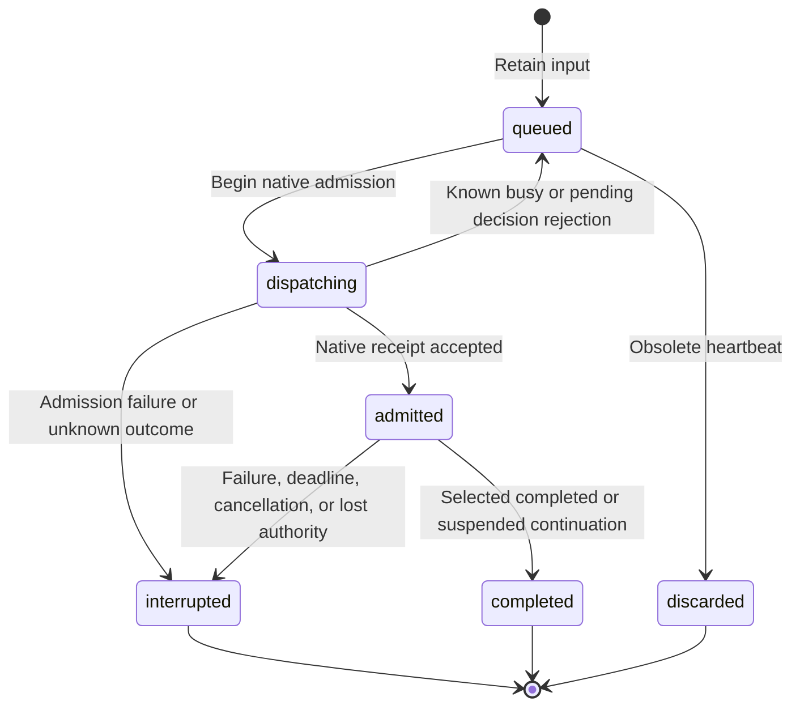

# Bot and Connector Ingress

## Design Position

Bot is one instance-wide personal assistant in a WebUI-mode App. It coordinates ongoing objectives through ordinary working Threads and uses the existing root admission, Harness execution, continuation, working state, inspection, usage, and native workbench facilities. The Host owns wake-up policy and intentional communication. Bot adds bounded durable input intent, not durable execution or distributed recovery.

[Runtime and Surfaces](05-runtime-subagents-and-surfaces.md) owns ordinary root receipts and Thread collaboration. [Local Storage](03-local-storage-and-recovery.md) owns checkpoints and execution observations. This contract owns Bot identity, scheduling, input retention, publication, and the shared Connector inbox. Live remains independent.

## Identity, Composition, and Workspace

Bot has the reserved root identity `thread_bot`, built-in source kind `bot`, no Project, and no Coordinator parent. The Host creates the Thread lazily on accepted human input or selected Connector input. Reading its page or saving configuration starts no Run. Ordinary working Thread lists and recency omit Bot; direct inspection remains available. Ordinary input, configuration, archive, and delete paths cannot repurpose the reserved Thread.

The selected root YAML's parent owns Bot's exclusive `bot/` workspace, independently of the data root. Normal Thread files and global guidance remain available under existing Environment rules. Bot's instructions prefer creating or driving working Threads over doing substantial work in this coordination workspace.

The accepted `webui.bot` mapping selects a Model and optional custom instructions, never a configured Agent. An omitted/null Model follows only the Model of `defaults.agent`; a missing effective Model makes execution unavailable. Configured Agent instructions, children, Harness Plugins, and MCP selections are not inherited. The Host composes built-in instructions and capabilities, optional custom instructions, and captured global `AGENTS.md` under the existing user-role guidance contract. Model and instruction edits affect later Runs.

Bot receives ordinary native Thread collaboration plus these Bot-only tools:

- `create_project` validates and create-only publishes a normal Project resource through configuration acceptance. Creation returns a Project outcome independently of Thread creation or Run admission.
- `read_project_memory` lists or reads bounded files for any currently configured Project when memory is enabled. Reads are on demand and read-only. Project memories are neither mounted nor automatically injected into Bot context.
- `publish_bot_message` creates intentional human-facing communication for the current Bot input.
- `finish_silently` is a no-argument native output tool that successfully ends the current Bot Run with `None`. It is not an ordinary function tool. Bot calls it without accompanying text when no human-facing response is needed, including after proactive publication. Empty model output is not the quiet-completion signal. The conversation renderer hides this tool's call and result in live and saved views; execution and continuation history retain the complete pair. It produces no publication, unread change, or notification.

`create_thread` creates ordinary working roots with normal Sidekick/global Agent defaults rather than inheriting the built-in Bot source. Existing receipt, ownership, discovery, and saved-result semantics apply. Bot cannot message, run, or steer itself. Worker messages and completion do not wake Bot.

## Configuration and Scheduling

All fields below belong directly under `webui.bot`:

| Field                        | Default | Contract                                                   |
| ---------------------------- | ------- | ---------------------------------------------------------- |
| `model`                      | `null`  | Existing Model ID, or global default Agent's Model only    |
| `instructions`               | `""`    | Optional custom instructions, at most 1,048,576 characters |
| `heartbeat_enabled`          | `true`  | Enables periodic heartbeat opportunities after activation  |
| `interval_seconds`           | `3600`  | Heartbeat interval, 60–86,400 seconds                      |
| `connector_interval_seconds` | `60`    | Shared inbox delivery interval, 1–86,400 seconds           |
| `run_timeout_seconds`        | `180`   | Wait deadline for an admitted Bot input, 10–3,600 seconds  |

One WebUI App holds a nonblocking local ownership lock per data root. Other Apps can inspect saved facts but cannot process Bot input. The Host persists activation, pause, next heartbeat time, last attempt, and the latest interruption diagnostic. Shutdown relinquishes ownership; no distributed lease is introduced.

The first accepted human input activates heartbeat scheduling. Successful idle Connector admission also activates it. Before activation, elapsed time alone creates no Thread or model request. A due tick retains at most one pending heartbeat; missed intervals coalesce. A full input queue cannot prevent existing queued work from dispatching. An active root operation or pending human decision blocks new Run admission. A heartbeat is an opportunity to inspect saved objectives and outcomes, never approval or proof that work completed.

Pause suppresses automatic heartbeat and Connector delivery, discards queued heartbeats, and leaves direct human input usable. It does not cancel an already active operation. Resume resets the next heartbeat opportunity. Disabling heartbeat suppresses heartbeat input while preserving direct input and Connector policy.

## Input and Publication Lifecycle

The shared database retains at most sixteen pending Bot inputs. An input records its ID, source (`user`, `heartbeat`, or `connector`), text, creation time, lifecycle state, optional receipt/continuation correlation, and diagnostic. Human submission uses an exact caller-provided ID and text. Repeating the same pair returns the retained input; reusing an ID for different content fails.

Deferred human responses use the existing explicit decision API and continuation validation. Their input correlation is retained before native admission; a rejected response is discarded. Automated input cannot answer a human decision. Browser navigation, page presence, root completion, self-messages, and worker reports create no wake-up input.

Intentional messages have independent durable IDs and user/assistant roles. Human input and its ordinary final answer appear in the Bot conversation. Heartbeat and Connector final output stay in Activity unless Bot explicitly publishes a useful result, blocker, or question. Repeated publication IDs deduplicate messages. Publications drive existing unread and notification facilities; internal root completion does not generate a second human-facing result.

The `/bot` page reuses the existing conversation reader, Markdown rows, Composer, sidebar, and native files/browser panels. It displays intentional messages. Activity opens the ordinary reserved Thread inspection view with execution history and pending decisions. Bot text input is a tab-local draft, not the shared collaborative Thread composer. An uncertain submission retains its exact command across navigation and offers explicit retry; the browser never automatically replays it.

## Recovery and Completion Boundaries

Queued inputs survive App restart. An owning successor marks old `dispatching` or `admitted` inputs interrupted, pauses automated processing, and asks for inspection of saved activity and effects. It never infers completion from an idle Thread, replays uncertain inputs, or reconstructs process-local root receipts. A timeout cancels the exact receipt and pauses automation; cancellation does not roll back completed tools. Explicit human follow-up remains possible while paused.

Project creation, working Thread creation, Run admission, saved execution result, Bot input completion, and intentional publication are separate outcomes. The model must inspect saved working Thread results before claiming success. Connector consumption has its own earlier acceptance boundary below.

## Shared Connector Configuration and Inbox

Connector instances use private instance-database configuration, separate from file-defined Agent resources. A record has a stable Connector ID, kind, enabled flag, selected event types, private settings, and private credentials. Settings and credentials are excluded from ordinary safe serialization. Credentials are plaintext in the local database; Host filesystem/database protection owns confidentiality. Concrete adapters own fixed business tables partitioned by Connector ID, not dynamic per-instance tables or a generic event-processing engine.

Adapters normalize selected events into bounded model-visible envelopes containing input ID, Connector ID, event type, stable source event ID, text, and creation time. External text is context, never human approval. Credentials and private adapter state must not enter envelopes. Text is limited to 16,384 characters. Disabled or unselected events do not enter the inbox. Pending rows deduplicate by Connector ID and source event ID; this is pending retention, not a permanent event log.

Adapters can enqueue envelopes in the same short database transaction that advances their own cursor or business state. Neither operation performs external I/O inside the transaction. Provider calls happen outside it. A source cursor must not advance while selected input is silently lost.

At each delivery opportunity the Host selects an ordered cross-Connector batch of at most 32 envelopes and 60 KiB of serialized content. With a busy Bot it attempts steering of the exact active native receipt. With an idle Bot it uses ordinary root prompt admission. Pending human decisions hold delivery. A rejected or stale steering attempt does not fall through to a replacement Run.

Native prompt or steering acceptance consumes exactly the selected inbox IDs. Model acknowledgement, tool success, final output, and task completion are not prerequisites for consumption. Other/new inbox rows remain. Rejected attempts retain the batch for a later periodic opportunity. Loss between native acceptance and local deletion can redeliver external content; adapters and working Threads must reconcile uncertain external writes rather than assuming exactly-once execution.

This foundation exposes no concrete provider setup, registration UI, polling adapter, or provider write tools. Those surfaces build on the same configuration and inbox boundary.

## API and Compatibility

Instance-key users access `GET /api/bot`, `POST /api/bot/inputs` with `{input_id, text}`, and `POST /api/bot/pause` with `{paused}`. Scoped guests have no Bot access. Queries are observational; successful input submission means retention, not Run admission or completion. The generated OpenAPI document owns exact response schemas.

One additive local schema migration creates Bot state, input and message storage plus shared Connector configuration and inbox storage, and expands the Thread source-kind constraint for `bot`. Existing Threads and checkpoints retain their semantics. Downgrade refuses existing Bot Threads rather than reclassifying them into a user Agent source.
