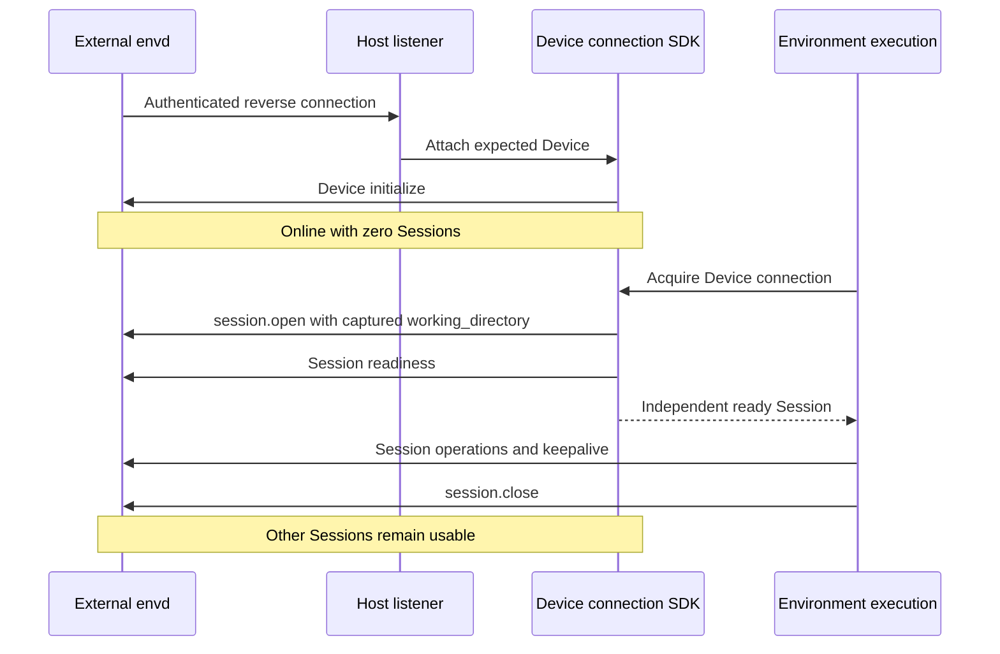

# Environment Execution Providers

[Environment Execution](08a-environment-execution.md) owns connection, state, operations, failure, and resource-lifetime boundaries. This document owns backend-specific execution and local/remote Device guarantees. [Service Environment Management](../a13n-service/06a-environment-management.md) owns native target allocation, stop/resume, destruction, and renewal guarantees. The Host selects and authorizes targets; Harness execution scopes use those targets and release their acquired resources.

## Built-in Providers

Eleven built-in execution definitions and implementations ship with Harness across two operation routes. Native managed backends have separate Service management definitions; Harness definitions expose execution capabilities only. Built-ins use the same authoring contract as installed plugins.

| Route  | Type             | Backing target                              | Operation backend            | Target management owner                    |
| ------ | ---------------- | ------------------------------------------- | ---------------------------- | ------------------------------------------ |
| Native | `direct_local`   | Existing Host directory                     | Local OS file/process APIs   | Host-supplied directory                    |
| Envd   | `local_envd`     | Local folders and a Host-owned daemon       | EIP over shared stdio        | Execution-owned Session; Host-owned daemon |
| Native | `docker`         | Docker container                            | Docker Engine API            | Service or an external Host                |
| Native | `e2b`            | Native E2B sandbox                          | E2B SDK and bounded commands | Service or an external Host                |
| Native | `daytona`        | Daytona sandbox                             | Toolbox commands             | Service or an external Host                |
| Native | `modal`          | Modal sandbox                               | Async SDK commands           | Service or an external Host                |
| Native | `vercel`         | Named Vercel Sandbox                        | Native command stream        | Service or an external Host                |
| Native | `sprites`        | Persistent Fly.io Sprite                    | Native WebSocket exec        | Service or an external Host                |
| Native | `runloop`        | Runloop Devbox                              | Native commands              | Service or an external Host                |
| Envd   | `http_envd`      | External daemon at a configured origin      | EIP over HTTP(S)             | Connect-only                               |
| Envd   | `websocket_envd` | External daemon reverse-connected to a Host | EIP over accepted WebSocket  | Connect-only; Host-integrated SDK          |

Envd-backed Environment Providers use `a13n-envd-client` to perform file, shell, process, output, and port operations over EIP against an Envd daemon. Native Environment Providers implement these operations through local OS or vendor APIs without requiring Envd. No Provider emulates an unsupported operation through a different backend; unsupported operations fail explicitly.

Each definition projects a configured descriptor without target I/O; Environment connector opening validates the live descriptor before exposing execution operations. The Host may restrict declared operations through its authorization policy, and the Harness applies those restrictions before dispatch; the provider implements its advertised capabilities. Stable environment identity is allocated by the Host per Environment and supplied at construction, never frozen into a reusable recipe; a Provider may retain its non-secret ownership correlation in state or labels to recover a dispatched creation.

### Direct Local

`direct_local` denotes access to an existing Host-controlled directory over the embedding operating system. Its recipe declares the root, optional shell profiles, allowed executables, environment-inheritance policy, allowed ports, and finite value, process, wall-time, buffer, and spool limits. The root, shell executables, and allowed executables are absolute after user expansion; profile IDs are unique. The root is always writable: the Harness can withhold file-write actions under Host policy, but that restriction cannot constrain an allowed native process running under the embedding OS account. The account configuration is empty: the Host filesystem is the backend.

Text reads apply `max_value_bytes` to the actual UTF-8 page rather than the product of requested line count and line length, so a valid oversized request returns a shorter successful page. Pages end before the next whole line that would exceed the budget; `lines_read` counts returned source lines and `has_more` reports later lines. A single line that cannot fit an otherwise empty page returns its bounded UTF-8 prefix, preserves a trailing LF, and records the one-based source line number in `truncated_lines`; `has_more=false` therefore does not imply that a shortened line was complete. Invalid UTF-8 and NUL remain errors even in a discarded suffix.

Commands run on POSIX hosts and native Windows without WSL or a daemon. Each command owns a POSIX process group or a Windows Job Object, assigned before execution so descendants cannot escape ownership during startup. Root exit and complete tree cleanup are separate observations. The default `posix` dialect retains `-c` and optional login semantics; a `powershell` profile disallows login, passes an encoded command, and selects UTF-8 for redirected text. `inherit_environment` defaults to false; when enabled, each command copies the Host process environment at launch, removes `unset` keys, then overlays `set` values without mutating the Host or other commands. `allowed_environment_keys` gates explicit set and unset keys only and does not filter the inherited baseline; Windows key matching is case-insensitive. Environment values stay runtime-only and never enter configuration, state, descriptors, or backing identity. POSIX supports interrupt and terminate signals; Windows supports tree termination and kill, and an interrupt request returns `environment_unsupported` rather than pretending a forced termination is graceful. Native execution enforces no memory, CPU, process-count, or network-denial limit and rejects requests requiring them.

Direct Local has `state=None`; the recipe is the deterministic target. `connector.open()` validates that the configured root exists and is accessible, constructs fresh local facets, and establishes process ownership within the `EnvironmentExecution`. Inaccessibility is unavailable evidence, never authoritative absence; Direct Local never creates the root. `close()` terminates and releases only the processes, streams, retained output, and handles that `EnvironmentExecution` owns. Direct Local exposes no target-management methods: it never allocates, locks, backs up, or deletes the Host directory and requires no target keepalive.

Live descriptors expose bounded `backing_identity` evidence binding the Provider, Host filesystem namespace, resolved root file identity, and configured operation policy. An ordinary content edit preserves it; replacing the root or changing the policy invalidates it. The field is absent when the filesystem supplies no usable identity evidence. This evidence is neither a content digest nor a lock, and guarantees nothing against file-ID reuse or hostile concurrent namespace changes.

Direct Local makes no sandbox, account-isolation, network-isolation, or race-free filesystem-broker claim; its confinement is a provider operation policy over one Host-selected root. File writes stage complete candidates before publication, and `move(replace=False)` uses one native no-replace rename on Linux, macOS, and Windows, so a concurrent destination publication is a conflict that preserves the losing source. Platforms without that primitive return `environment_unsupported`; cross-filesystem moves are unsupported. `move(replace=True)` replaces nonempty same-kind directories using atomic exchange on Linux and macOS, then removes the displaced directory at the source. The caller owns the source until completion; cleanup failure after publication reports `environment_unknown_outcome`. Windows replaces existing directories by removing the destination and renaming the source, accepting a visibility gap and incomplete outcomes on failure or concurrent writes. Other platforms or filesystems without atomic directory replacement return `environment_unsupported` and preserve the old destination. Guest helpers use the same directory publication semantics on Linux and macOS. File copy already stages a complete candidate before publication; hosts can stage a package through file copies or writes and publish it with one directory move.

On POSIX hosts, new files use ordinary `0666` creation permissions filtered by the Host process umask; Direct Local does not change that process-wide mask. Replacing an existing file, including append and patch publication, preserves its ordinary access and executable bits without transferring special set-ID bits. Candidates remain private until publication. File writes do not promise ownership or ACL preservation.

### Local Envd

`local_envd` provides local EIP operations through a Host-owned daemon. Its reference-only recipe contains a working directory, required methods and optional Session egress configuration under the [remote path contract](#remote-envd). The working directory is an existing Device path, not a filesystem access boundary.

The Host's runtime collaborator lazily resolves an exact executable, supplies typed execution, Sandbox and egress launch configuration, and shares the stdio Device connection across compatible Environment execution scopes. Envd owns the complete Session worker boundary and cleanup; the Host does not wrap the daemon in a second Sandbox. Device policy changes require separate launches. Session destinations, credential references and revisions do not enter the daemon cache key. A separate explicit executable resolver can consult an explicit path, `A13N_ENVD_EXECUTABLE`, then `PATH`; definition construction performs no executable or credential resolution.

Local launch configuration exposes native `full_control` and `computer_use` switches, both disabled by default. Full Control delegates shell selection to envd and excludes explicit shell profiles and trusted executable roots. Computer Use requires a disabled Sandbox and inherited egress; its positive `computer_permission_timeout_ms` defaults to 120,000. Device initialization allows that permission wait before failing, so an OS authorization prompt is not cut short by the ordinary request timeout. Selecting these launch inputs follows the [native daemon contract](../a13n-envd/01-daemon-lifecycle-and-configuration.md); it does not grant operations beyond the Host's mount permissions.

The local launch configuration also accepts optional [Device resource monitoring](../a13n-envd/11-resource-monitoring.md): sampling interval, named filesystem targets and a selected Linux cgroup. The SDK default disables sampling. These trusted launch inputs are independent of Session policies. `running_device()` returns only an existing, nonterminal connection or `None`; observing it never launches or restarts a daemon. The runtime's `device_id` identifies its process-local daemon owner. Hosts own any polling and history above the client.

Local, HTTP and WebSocket Envd use the same Session egress model: explicit tagged destinations and secret bindings containing `env`, `source: {kind: environment, name: ...}` and exact `inject_hosts`. Environment connector opening resolves these sources freshly through a runtime credential collaborator immediately before Session opening. Missing or empty values fail preparation; source variables are excluded from local daemon child inheritance. Captured definitions, portable state, descriptors and cache identity contain references or nonsecret metadata only, never resolved values. Remote recipes can require an exact Sandbox/network boundary and optionally native identity or privilege-gain blocking; mismatches fail before exposing operations. The provider-neutral descriptor's `execution_boundary` projects the EIP `boundary`, including the effective policy digest.

Local Envd retains no durable target beyond Host-selected files and returns `None` state; the Host-owned connection runtime, not portable state, preserves a daemon across independent `EnvironmentExecution` scopes. `connector.open()` acquires the ready Device connection, opens a fresh Session with the captured working directory, verifies method compatibility and readiness, and exposes operation facets. Opening cancellation closes only the newly created Session; failing to open one Session never kills a healthy shared daemon. `close()` fences execution operations, stops Session keepalive, and closes that Session and its owned commands, output, and transfers while preserving the carrier and daemon. Local Envd declares no stop, destroy, or renewal capability, and workspace files are never deleted by close or collection. After opening, `backing_identity` uses the same Host filesystem evidence as Direct Local plus the effective launch configuration; a fresh Session does not change it, while root replacement or a changed launch boundary does.

### Docker

`docker` attaches to an existing running container through the Docker Engine SDK. In its default native mode (`execution="native"`), no Envd executable, EIP connection, bootstrap credential, or control port exists in this execution backend. Account configuration supplies `docker_host`; Service owns the [allocation recipe and lifecycle](../a13n-service/06a-environment-management.md#docker).

The selected image must provide Linux, Python 3.10 or later, the configured shell, and a user able to write `/workspace` and `/tmp/a13n`, with Git additionally required for Git-ignore queries. Files and ports use bounded one-shot Python standard-library commands through Docker exec and the common native helper. Execution validates target-compatible configuration and the initialization completion evidence without creating a container or rerunning initialization.

Access to the selected Docker Engine grants that Engine's Docker authority. The execution runtime owns its Docker client with cancellation-safe acquisition and bounded teardown, runs SDK I/O off the event loop, and applies a finite request timeout. It never acquires images or creates containers.

State contains the allocation's `environment_id`, exact `container_id`, and `configuration_fingerprint`. Canonical target identity is the container ID. `connector.open()` attaches only to that validated running container. A connection failure is not absence, and a stopped or lost target is reported without starting or replacing it. `close()` disconnects observations while preserving the container and its background processes.

Commands use native Docker exec with a configured shell or explicit argv, supporting stdin, separate stdout and stderr, bounded output, explicit process inspection, and targeted signaling. Signal controls verify the command's in-container PID generation before signaling its group and never stop the shared container; process-tree cleanup is not promised. Per-command resource limits and network policies the container cannot enforce are rejected explicitly. Output observations are scoped to the current Environment execution, with per-stream and aggregate limits that discard excess bytes and report incomplete coverage. Rebinding a known exec identity can inspect native status but does not reconstruct lost output or stdin, and native command output is never replayed after a Worker restart.

With `execution="envd_http"`, Docker attaches to the existing image-managed envd using the existing authenticated HTTP EIP client. Account `envd_http` configuration independently supplies the reachable `host`, optional Engine port-publication `bind_host` (defaults to the reachable IP, or `127.0.0.1` for `localhost`; other hostnames require an explicit listen IP), explicit `allow_plaintext_private_link` opt-in for non-loopback routes, and the image's protected `credential_file`. It never infers an envd hostname from `docker_host`. Each attachment inspects port `8888/tcp` on the exact owned container and requires one binding on the configured interface; this discovers a new published port after stop/start without changing container identity. The Host endpoint policy applies to that actual URL before credential retrieval or HTTP dialing. The Engine remains the source of port allocation truth; a stale endpoint is not persisted as target identity.

The image creates a separate HTTP credential file for each container. Docker retrieves it through its authorized Engine connection using a bounded helper; the credential is held only in memory and never copied into portable state, template JSON or public API responses. All Agent operations, including files, processes and Computer, then use HTTP EIP directly, without an exec relay or local listener. EIP initialization checks the allocation's expected device ID. Execution close releases its EIP Session/client, not the container. The optional `desktop=true` requirement requires `envd_http` and negotiates Computer methods; EIP execution without a desktop is also supported. Attachment never starts or replaces a missing/stopped container. The network must permit the forward route; this implementation does not add TLS termination, reverse WebSocket Service ingress or NAT traversal.

### Cloud Providers

E2B, Daytona, Modal, Vercel Sandbox, Fly.io Sprites, and Runloop each declare typed account settings, a private credential model, and one recipe model. All six expose files and shell execution through native transports. E2B additionally exposes native process observations, stdin, retained SDK text output, and loopback ports; the other five expose bounded foreground execution only, and unsupported process, output, port, resource, and network features fail explicitly.

Daytona, Modal, Vercel Sandbox, Sprites, and Runloop share command composition over the canonical file helper, with staged file publication and a bounded one-shot guest command runner. Service implements native management and Harness implements execution transports; the common operation layer never dispatches on Provider type. REST uses the canonical async HTTP client, Sprites exec uses binary WebSocket frames, and Modal uses its async SDK and explicitly detaches sandbox command-router resources on local close.

The shared guest file publication used by Docker and all six cloud Providers preserves an existing regular file's ordinary access and executable bits on replacement, including append and patch, without transferring special set-ID bits. It applies those permissions to the completed candidate before atomic publication. New files retain the mode produced by guest staging and upload; the helper does not change the guest process umask. Write paths follow in-root symlinks to their resolved target. File writes do not promise ownership or ACL preservation; append and patch remain read/modify/write operations rather than compare-and-swap transactions.

Native file batches execute in one guest helper invocation, including small inline text writes without separate file uploads. Direct Local and Envd execute the same ordered operations through their file primitives. Every provider implements the batch and archive contracts explicitly; failures do not trigger another transport or replay.

Archive writes transfer the ZIP through the provider's file transport and extract its manifest inside the guest, verifying the transferred archive's checksum before extraction. The configured file limit bounds both the ZIP transfer and each expanded member. Extraction creates a new directory without restoring archive permissions or links; an existing destination, including a symlink, is a conflict. Direct Local and Envd implement the same archive operation through their bounded file primitives. An uncertain transfer is not retried through another implementation.

State validates the Provider type, exact codec version, recipe fingerprint, and native target ownership before managed use. Names and labels correlate an allocation to the Environment, never a Session. Replacing a confirmed missing target requires explicit Host allocation; opening an Environment execution never replaces it. External state is mandatory and external connections never allocate; external-target destruction rules belong to Service management. Native names that can be reused retain backing identity evidence separately, so stale state cannot silently delete a different target at the same name. State and recipes never contain credentials, resolved toolbox endpoints, WebSocket URLs, SDK clients, or live native session handles.

Native lifecycle, stop preservation, expiry, allocation recovery, and deletion guarantees belong to [Service cloud management](../a13n-service/06a-environment-management.md#cloud-providers). Execution close fences local operations and releases transport resources; cancellation does not claim immediate remote process termination. Native local rejection is `not_dispatched`; observed command completion is `known`, including nonzero exits; malformed or oversized mutation acknowledgements and lost responses remain `unknown`.

#### E2B

Target-compatible configuration selects logical filesystem `root` (default `/home/user`), sandbox `user`, the Python executable used by file and port helpers, request timeout (default 30 seconds), and finite file, traversal, and observation bounds. `max_file_bytes` defaults to 100 MiB and accepts positive values up to 1 GiB; explicit smaller limits remain effective. Template, sandbox-wide internet access, and TTL allocation settings belong to [Service E2B management](../a13n-service/06a-environment-management.md#e2b). `max_active_observations` defaults to 128 concurrent native attachments, `max_observation_bytes` to 1 MiB cumulative combined stdout and stderr per observed command, and `max_retained_output_bytes` to 128 MiB retained text across the Environment execution.

Account configuration supplies the backend domain and an optional HTTP(S) `api_url`; the credential supplies the API key. Execution calls use the explicit API URL or `https://api.<domain>` and never inherit an ambient API URL. Harness loads no `.env` file and acquires no ambient credential. Commands use the official asynchronous E2B SDK's public `run`, `list`, `connect`, `kill`, `send_stdin`, and `close_stdin` operations; file and port helpers use bounded Python standard-library commands. Ordinary execution requires no guest command supervisor, PID registry, capture file, `a13n-envd`, executable upload, or template build. The selected template supplies Linux, Python 3.11 or later, Bash, the selected account, and the existing root, with Git additionally required for Git-ignore queries.

Native E2B enables the Computer facet only with `desktop=true`. The official `e2b-desktop` Python SDK owns desktop creation and native screenshots/input; the base asynchronous SDK continues to own ordinary commands, files and process operations. Service owns initialization; execution attaches a synchronous Desktop client to the already validated sandbox identity, domain, access token and routing configuration without calling resume-capable `connect()`. No a13n-envd, EIP, VNC startup or public desktop port is required. Compatible templates supply the official desktop runtime (Xvfb, XFCE, xdotool and scrot) and fonts for the required languages. Attachment and input do not install fonts. Named chords use the SDK's allowlisted key names and ASCII alphanumerics. Text uses the SDK's default typing pace with separate calls for non-ASCII characters; LF, CRLF and CR become native Enter keystrokes, preserving empty and trailing lines. Text dispatch checks the request time budget between chunks; the current SDK command retains its own timeout. An interrupted or timed-out text action may be partial and is never replayed. Text success reports native dispatch, not application-level Unicode acceptance or isolation from another keyboard client.

Computer observations retain at most 16 references for 120 seconds per execution. They bind execution, the observed Xvfb process identity and geometry; resized-image coordinates map back to native pixels. Invalid, foreign, expired or changed desktop references fail before input. Geometry is checked before and after SDK capture. Returned native images are rejected above 32 MiB, encoded JPEGs above 4 MiB, and dimensions above 4096 per axis. Native capture files and their normal cleanup belong to the Desktop SDK; the adapter does not provide a separate guest capture registry. Closing execution releases both local observation references and the synchronous SDK transport without stopping the desktop.

Synchronous SDK operations run off the event loop with bounded native command/request timeouts. Cancellation drains the in-flight SDK task before releasing the input lock or transport, without replaying it. The adapter handles SDK zero-coordinate and same-position movement behavior and composes drag button/duration using SDK mouse methods, always attempting release of its drag button. Failed key chords use a fixed allowlisted key-release command because the SDK exposes no key-release method. Failed or lost acknowledgements preserve uncertainty and block further input in that execution; observations remain available for reconciliation. The SDK does not expose an already-held-input probe, so the adapter makes no exclusive-desktop or global input-state guarantee. A new execution does not prove a previous input was rolled back. Vertical step scrolling is supported up to 100 steps; horizontal and pixel scrolling fail before dispatch rather than being silently approximated.

State contains `sandbox_id`, the owning `environment_id`, and a `configuration_fingerprint` covering target-compatible template, root, user, and internet-access settings but not local observation budgets. Desktop-enabled fingerprints additionally cover desktop configuration. Disabled desktop defaults preserve the historical fingerprint byte-for-byte. Execution validates ownership metadata and exact target identity; allocation recovery and coordination belong to Service.

| Target evidence                                 | Execution attachment behavior                                                     |
| ----------------------------------------------- | --------------------------------------------------------------------------------- |
| Running                                         | Attach to the same sandbox without extending its lifetime                         |
| Paused or stopped                               | Return a distinct stopped-target failure; only explicit Host `start()` resumes it |
| Confirmed absent                                | Return missing-target failure without allocating a replacement                    |
| Running during lookup, paused before attachment | Attachment itself must not resume it; fail with the available evidence            |
| Transport timeout or uncertain outcome          | Preserve uncertainty; do not infer absence, resume, recreate, or replay commands  |

These guarantees apply to initial opening and reconnection as well as readiness. Attachment uses an SDK/API path whose actual semantics satisfy them; a lookup before a resume-capable or lifetime-extending `connect()` does not. Unsupported backend versions report that limitation rather than silently enabling lifecycle effects. Lifecycle mutation remains confined to explicit management calls.

`close()` disconnects SDK observations and fences local facets without killing commands or the sandbox. A fresh Environment execution opened from state can discover running commands the sandbox still exposes, but unchanged sandbox identity does not prove command survival, and an exited command absent from the native inventory has no invented exit result. Stop, destroy, and target keepalive belong to Service management.

Files support bounded raw reads, streamed SDK transfers, UTF-8 text, shared unified-diff semantics, traversal, search, atomic staged publication, copy, move, and deletion. Logical paths resolve beneath the configured root, which is a file-API boundary rather than shell confinement. Append and patch are read/modify/write operations, not compare-and-swap transactions. Port operations inspect or wait for loopback TCP listeners only. The `default` shell profile uses native login Bash; explicit non-login mode, direct argv execution, environment unsets, and unknown profiles are unsupported. Native stdin is bounded per request to 1 MiB. Native kill is SIGKILL; interrupt, terminate, and verified process-tree cleanup are unsupported. E2B enforces no per-command hard wall-time limit, and explicit execution deadlines, cumulative stdin quotas, CPU, memory, and process-count limits, and per-command network denial on an internet-enabled sandbox fail before dispatch.

Output uses `origin="sdk_text"`; producer totals and completion are unknown even when the SDK supplies terminal status. Only active native attachments, including in-flight start and connect reservations, count against observation concurrency, and finished or disconnected observations release that slot immediately. Status and reference metadata are separate from output retention: an Environment execution admits at most 100,000 unreleased references and requires explicit release before admitting more. The aggregate retained-output budget evicts the oldest closed observations' output first while preserving reference metadata, known terminal status, and cumulative per-stream end offsets, so reads report `observation_evicted`, partial coverage, and an advanced `available_start` rather than silently rebasing a log to zero. Active buffers are not evicted; when only active logs remain without space, or a command reaches its cumulative output limit, the execution stops that observation and disconnects its SDK stream rather than the command. Waits use one monotonic budget covering native status queries and stream attachment; a zero timeout performs one status poll bounded by the native request timeout. Timeout returns the latest observed status without inventing completion, and cancellation releases the local observation without killing or replaying the native command. Native listing is not paginated by the locked SDK: the execution bounds its projection and reports `has_more` without claiming a server-side cursor.

#### Daytona, Modal, Vercel Sandbox, Sprites, and Runloop

Daytona opts into the Computer facet with `desktop=true`; omitted or false preserves existing headless configuration fingerprints and capabilities. The adapter uses the official Computer Use HTTP API over the authenticated toolbox transport. It requires one active display at the origin and checks display geometry and the guest boot/Xvfb process identity before and after capture. Observations are execution-local, expire after 120 seconds and are bounded to 16 entries; scaled image coordinates map to native pixels. Screenshot dimensions are bounded to 8192 per axis, incoming payloads to 32 MiB and encoded JPEGs to 4 MiB. Both scroll axes accept at most 100 native steps; pixel scrolling is unsupported.

Text uses bounded ASCII chunks and individual non-ASCII characters through the official typing endpoint, with explicit native Enter between normalized LF/CRLF/CR lines. Fonts and desktop packages belong to the snapshot. Input is serialized per execution; cancellation drains the bounded dispatch before releasing local clients, and compound gestures have one request time budget plus bounded release cleanup. A timeout or failed input response can leave a partial or still-running upstream action. The adapter blocks further input in that execution and never retries the action. Closing or opening an execution does not prove upstream input has stopped; the Host must reconcile uncertain input before reuse. This capability alone grants neither human access nor exclusive desktop ownership.

Daytona defaults to writable `/home/daytona` and guest-PATH `python3`; Sprites uses `/home/sprite` and guest-PATH `python3`; Runloop uses the unprivileged user's writable `/home/user` and guest-PATH `python3`. Vercel Sandbox uses Python 3.13 and `/vercel/sandbox`; persistent target identity survives native session stop/resume, while session identity fences observations. Modal uses an existing deployed App; execution creates no App and deletes no Host-supplied image.

Fly.io Sprites can wake automatically when its native service executes a command. This provider-declared native behavior is distinct from an explicit management `start()` call; Harness performs no separate lifecycle dispatch. Durable disk, stop/resume, snapshot ownership, expiry, and deletion semantics belong to [Service management](../a13n-service/06a-environment-management.md#daytona-modal-vercel-sandbox-sprites-and-runloop).

### Remote Envd

`http_envd` and `websocket_envd` connect to externally operated Devices. They provision, start, stop, delete, and renew nothing: their execution definitions contain no management factory, and Service registers no management lifecycle for them. EIP Session keepalive is separate from target renewal. HTTP is Host-dialed; reverse WebSocket is daemon-dialed, with envd always the responder. A Host-owned Device connection serves several fresh execution-owned Sessions, and the Harness owns each execution and its Session independently of other executions.

| Concern                                                                           | Owner                     |
| --------------------------------------------------------------------------------- | ------------------------- |
| Daemon deployment and outer security boundary                                     | Operator or Host          |
| Device registration, endpoint, credentials, listener and trusted folder selection | Host                      |
| Framing, multiplexing, Session controls and transfers                             | Low-level EIP client      |
| Bounded process-local Device connection registry                                  | Host-owned connection SDK |
| Fresh execution, folder configuration and provider-neutral operation translation  | Remote Provider           |
| Cross-process routing, durable records and product policy                         | Host                      |

A Session is a resource owner, not a tenant sandbox. Device and working-directory selection are trusted Host inputs; operation arguments do not confer authority to select another Device. The SDK owns no listener, global registry, credential issuer, or distributed relay.

The shared credential-free recipe contains `working_directory` and exact `required_methods`. Paths use the [Device path model](../a13n-envd/04-resource-operations.md#path-model), never the requester's filesystem. An omitted working directory resolves from Device info at connection opening; a Host requiring an immutable directory selection resolves and supplies it before constructing the connector. Validation is structural and inert; Session opening checks availability. The execution's provider-local `/` is the Device filesystem namespace rather than the selected directory: Device paths translate directly, and relative inputs and an omitted command cwd use the captured working directory. Required methods assert compatibility, not permissions.

External state contains the stable native `device_id` under the Provider's versioned state envelope, and unsupported state versions fail validation. Every connection that state drives expects that `device_id`: a daemon that is another Device refuses to initialize as incompatible, which `http_envd` reports as the invalid `provider_device_mismatch`, since the client offers only its own protocol version. State excludes endpoints, credentials, sockets, Sessions, generations, heartbeat state, and application policy. `target_identity()` identifies the Device within the Host's immutable backend selection, not one folder binding; the Host owns resource deduplication, and distinct accepted folder bindings retain independent Session scopes.

The HTTP account configuration supplies a credential-free origin, an explicit private-link plaintext choice, finite connection and request timeouts, and bounded concurrency, with a required credential and TLS configuration supplied at runtime. Public origins use verified HTTPS by default; the Host can explicitly disable certificate verification through trusted runtime TLS configuration. Plaintext requires an explicitly trusted local or private deployment, and credentials never appear in URLs or portable state. One backend selects one origin, and changing it is an explicit Host target change. The WebSocket account configuration supplies a finite connection-acquisition timeout; the Host supplies the connection SDK through the runtime factory rather than a listener address in configuration, and an unwired Provider stays inert and fails runtime creation explicitly. The Host authenticates the upgrade, negotiates `eip.v1`, and resolves the expected Device identity before handing an accepted connection to the SDK. One SDK instance is a bounded process-local trust scope in which at most one active connection represents a Device; duplicates are rejected without replacing the active owner, while different Devices can be online simultaneously.

The connection SDK exposes authenticated Device info and bounded directory listing without opening an execution or Session, and HTTP uses the same EIP methods directly. Host authorization applies before discovery, no execution scope is required, and a discovery failure affects only that request.

Attachment performs the Device handshake immediately, even when no execution is waiting, and the Host awaits the attachment handler for the carrier lifetime. Acquisition waits for the matching Device under a finite deadline; cancelling a waiter neither consumes nor closes the connection. `connector.open()` opens one independent Session, checks required methods and readiness, and exposes operation facets, and the client maintains Session keepalive for the execution's lifetime. Cancelling preparation or closing the execution stops keepalive and closes only that Session; it neither closes a borrowed carrier nor stops the remote daemon. A lost framed carrier detaches its Sessions for the EIP disconnect grace, and an existing owning runtime may explicitly reattach the same Session in the same generation while it remains valid; pending requests still have unknown outcomes when dispatch may have occurred, and reattachment never replays work or resumes transfers. An expired Session requires a fresh `EnvironmentExecution`, and old resource references stay invalid. SDK shutdown fences acquisition, closes owned Sessions and connections, and joins attachment handlers boundedly; an old handler removes only its exact connection, never a later replacement.

Remote Providers cannot authoritatively distinguish an unreachable machine from a stopped one.

#### Host Pairing

A Host implementing pairing exposes `POST /api/envd/pair` beneath its configured base URL. In this protocol, Host denotes that pairing server; it requires no particular application framework. Enrollment is separate from EIP and opens no Session. The daemon sends `{device_id, name}` and a generated 256-bit, lowercase hexadecimal Bearer credential. It saves the credential before contacting the Host. The Host retains only its SHA-256 verification digest, bound to the approved resource and native identity; this credential authorizes only the registered daemon's attachment, not ordinary product APIs.

A pending response contains `status: pending`, a `challenge` with `pairing_id`, `device_id`, `name`, `verification_code` and `expires_at`, an optional `approval_url`, and `poll_after_seconds`. The daemon repeats the authenticated request to observe approval. A challenge expires after ten minutes; polling does not extend its lifetime. Host admission bounds pending requests. Browsers receive only the safe challenge, never the credential. Approval requires the Host's ordinary authenticated management authority and explicit confirmation of the displayed code; a daemon's claimed identity grants no authority.

Approval atomically binds the verifier to the Host's Device resource. Repeated confirmation and lost-response recovery reuse that binding rather than creating another resource. A response with `status: approved` includes `resource_id` and a credential-free `websocket_url`. Approval and connection URLs may be relative to the paired Host URL. The daemon resolves relative values against that URL; connection URLs retain the same host, effective port and TLS level, with HTTP(S) mapped to WS(S). Identity changes under an existing pairing are rejected. Denied, expired or revoked requests return an explicit error; the daemon never replaces its credential or obtains new authority automatically after rejection.

The daemon saves the approved connection recipe and authenticates subsequent reverse WebSocket connections directly with the retained credential. It requires no external controller or per-reconnection ticket. Registration approval, transport connection, Device initialization and Host online publication remain distinct observations. Connection admission and takeover remain Host responsibilities, independent of how the attachment credential is verified.

Each daemon process selects one Host. One machine may run multiple independent instances or Host-targeted processes; each has separate runtime ownership. Installation identity and named Host profiles persist outside disposable runtime data. Host profiles isolate credentials by target; changing a profile's address cannot silently reuse its existing authority. Remote enrollment requires verified HTTPS, with explicit loopback HTTP available for local use. Credentials never enter URLs, redirects, logs or inherited command environment. Revoking a pairing prevents subsequent attachments and retires its active connection without deleting native files or rewriting execution history.

Harness owns enrollment values and verification helpers, not product user authentication, credential storage or HTTP listener ownership. The Host owns resource records, user approval, storage, listener routing, and whether pairing is offered at all. Endpoint-and-token connections do not require pairing.

### Host-local Backend Scope

Local Envd has process-local runtime ownership. Direct Local addresses directories in the filesystem namespace of the process running the Provider. The Host must ensure that every Harness using a saved target reaches that same namespace. Docker account configuration records its `docker_host` endpoint; the Host selects the Engine, and each Harness using the target must reach that Engine. The library provides no process scheduling or hostname affinity. Direct Local and Local Envd identify the selected workspace path without including access or connection state. Docker's canonical native identity is the exact container ID, independent of process-local connections; its reconciliation searches the frozen logical target's ownership labels, validates ownership and configuration labels, and caches a recovered container ID without starting the container. HTTP Envd connects to an externally operated daemon with its selected Device identity; an unreachable endpoint fails connection without starting or replacing the daemon.
