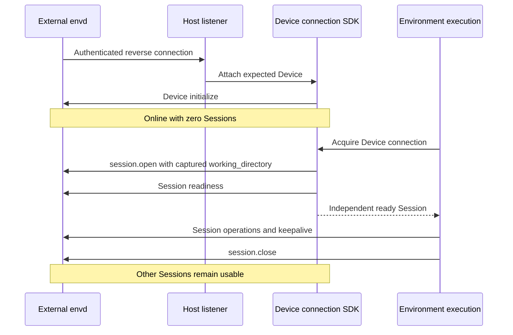

# Environment Execution Providers

[Environment Execution](08a-environment-execution.md) owns connection, state, operations, failure, and resource-lifetime boundaries. This document owns backend-specific execution and local/remote Device guarantees. [Service Environment Management](../a13n-service/06a-environment-management.md) owns native target allocation, stop/resume, destruction, and renewal guarantees. The Host selects and authorizes targets; Harness execution scopes use those targets and release their acquired resources.

## Execution Backend Boundary

Harness has two execution paths:

| Path             | Supported forms                                          | Capability scope                                                                                                                             |
| ---------------- | -------------------------------------------------------- | -------------------------------------------------------------------------------------------------------------------------------------------- |
| Native Execution | Local, Docker, E2B, Vercel Sandbox, Sprites, and Runloop | Files & Shell only                                                                                                                           |
| Envd             | General execution over EIP on a Host-selected target     | Files & Shell; execution policy enforcement through OS sandbox and Egress; advanced operations including Computer use and metrics collection |

Native Execution supports quick deployment and applications that need only basic capabilities. Shell includes the process control, stdin, output observation, and cleanup needed to run commands. Docker provides a containerized option for applications built with Harness and also supports an explicitly selected Envd route.

Envd owns the general execution capability model, including port operations, Computer use, and Device metrics. Available capabilities follow the daemon's advertised methods and effective Host policy. OS sandbox and Egress enforce the selected [Device boundary](../a13n-envd/07-execution-isolation.md). Metrics are [Device-scoped observations](../a13n-envd/11-resource-monitoring.md) collected by the outer daemon and read through the Host's Device connection.

Daytona and Modal use Envd through EIP for Agent operations. Vercel Sandbox supports an explicit Envd route alongside its existing native Files & Shell route. Sprites and Runloop expose native files and bounded foreground shell execution; their Envd integration is not implemented. This keeps general execution semantics in one daemon instead of maintaining a separate advanced execution stack for each vendor.

Each managed infrastructure vendor retains its own `EnvironmentProvider` subclass for resource management: allocation, inspection, start/stop, destruction, renewal, Envd bootstrap, and connection setup. Service owns the built-in management implementations; other embedding Hosts may supply their own. Harness adapts the shared EIP operations. Bounded vendor commands remain available for bootstrap and readiness under Host authority; Agent operations follow the selected Native or Envd execution path.

Envd-backed execution requires a compatible daemon, an authorized connection, and the requested methods and execution boundary. Missing prerequisites or unsupported operations fail explicitly; they never fall back to vendor-native execution. Legacy execution configurations outside the Native Files & Shell scope require an explicit transition or an actionable rejection. Native execution does not acquire Envd OS sandbox, Egress, or secret-masking guarantees merely by sharing the Environment interface.

Human desktop viewing, connection grants, revocation, and Service control coordination follow the separate [desktop access contract](../a13n-service/06a-environment-management.md#desktop-access-enforcement). A provider-specific viewer route can serve that contract without becoming a vendor-native Agent execution backend. Shared Computer tools, relative-coordinate handling, assistance, and takeover remain above this execution boundary.

### Envd Session Recovery

Environment connector factories accept the `session_recovery` keyword on every call, including `None`. Envd-backed execution uses this optional Host-owned collaborator per execution scope; native execution accepts it without producing Session hints. The Host stores its transport-neutral Session hint separately from portable Environment state and Harness state, and restores it only within the original logical execution scope. Shared Device runtimes and connection registries do not own these per-scope hints. Native execution has no Envd Session to recover.

Session acquisition validates the current target, Device identity and generation, execution boundary, requested working directory and required methods before attaching the saved descriptor. HTTP routes, including managed targets, bind the hint to the resolved endpoint; stdio and reverse WebSocket use Device identity. Transport establishment, current credentials, endpoint policy and managed-target ownership checks precede acquisition. Changed target or generation, incompatible directory or methods, and an unavailable saved Session cause a fresh independent Session to open. `NOT_INITIALIZED` means attachment is unavailable, including a framed Session still owned by another carrier; fallback leaves that owner untouched. A changed execution boundary within the same Device generation fails acquisition. Authentication, transport and compatibility failures propagate. Acquisition consumes the in-memory hint before attempting attachment; failure leaves that collaborator empty and does not itself rewrite the Host's persisted checkpoint. Controlled-egress Sessions use current policy resolution instead of restoring saved policy.

HTTP, stdio and reverse WebSocket use the same attach-or-open rule on an initialized Device. Recovery depends on the daemon retaining the Session: reverse-WebSocket reconnect preserves the daemon and permits attachment within its grace period, while the current stdio executable shuts down and cleans Sessions on EOF. A replacement stdio daemon opens a new Session in its new generation.

Attached Sessions retain normal close and abort cleanup, without fencing other clients or extending expiry. An old client's delayed cleanup can close an attached Session; subsequent operations fail without replay. Application process references and output observations remain local to each execution.

## Built-in Providers

Built-in provider types follow two operation routes. Managed targets have separate Service management definitions; Harness definitions expose execution capabilities only. Built-ins use the same authoring contract as installed plugins.

| Route         | Type             | Backing target                              | Operation backend                               | Target management owner                    |
| ------------- | ---------------- | ------------------------------------------- | ----------------------------------------------- | ------------------------------------------ |
| Native        | `direct_local`   | Existing Host directory                     | Local OS file/process APIs                      | Host-supplied directory                    |
| Envd          | `local_envd`     | Local folders and a Host-owned daemon       | EIP over shared stdio                           | Execution-owned Session; Host-owned daemon |
| Native / Envd | `docker`         | Docker container                            | Docker Engine API / EIP to the container daemon | Service or an external Host                |
| Native / Envd | `e2b`            | E2B sandbox                                 | E2B SDK / EIP to the sandbox daemon             | Service or an external Host                |
| Envd          | `daytona`        | Daytona sandbox                             | EIP to the sandbox daemon                       | Service or an external Host                |
| Envd          | `modal`          | Modal sandbox                               | EIP to the sandbox daemon                       | Service or an external Host                |
| Native / Envd | `vercel`         | Named Vercel Sandbox                        | Native Files & Shell / explicit HTTP EIP        | Service or an external Host                |
| Native        | `sprites`        | Persistent Fly.io Sprite                    | Sprites filesystem and exec APIs                | Service or an external Host                |
| Native        | `runloop`        | Runloop Devbox                              | Runloop binary file and command APIs            | Service or an external Host                |
| Envd          | `http_envd`      | External daemon at a configured origin      | EIP over HTTP(S)                                | Connect-only                               |
| Envd          | `websocket_envd` | External daemon reverse-connected to a Host | EIP over accepted WebSocket                     | Connect-only; Host-integrated SDK          |

Envd-backed Environment Providers use `a13n-envd-client` to perform Agent operations over EIP against an Envd daemon. Native Local, Docker, E2B, Vercel Sandbox, Sprites, and Runloop implement Files & Shell through their native APIs without requiring Envd. No Provider emulates an unsupported operation through a different backend; unsupported operations fail explicitly.

Each definition projects a configured descriptor without target I/O; Environment connector opening validates the live descriptor before exposing execution operations. The Host may restrict declared operations through its authorization policy, and the Harness applies those restrictions before dispatch; the provider implements its advertised capabilities. Stable environment identity is allocated by the Host per Environment and supplied at construction, never frozen into a reusable recipe; a Provider may retain its non-secret ownership correlation in state or labels to recover a dispatched creation.

### Command Environment Defaults

Local, Docker and the six managed cloud execution configurations expose `environment: dict[str, str]`, defaulting to empty. Each adapter combines defaults with the command's explicit set/unset immediately before dispatch. Explicit values win; supported unsets remove defaults. The resulting environment reaches ordinary child processes without changing the Host environment. Envd-backed managed providers send the same values through EIP command requests and retain daemon-side restrictions. Direct Local validates defaults against its allowed environment keys. Defaults are ordinary configuration, not a credential source; platform-owned bootstrap, telemetry and desktop variables cannot be supplied in this map. Service recipe lifecycle and validation are specified in [Environment management](../a13n-service/06a-environment-management.md#default-command-environment).

Omitted or empty defaults preserve existing provider target fingerprints. Nonempty defaults participate in recipe identity; serialized key ordering must not change that identity.

### Direct Local

`direct_local` denotes access to an existing Host-controlled directory over the embedding operating system. Its recipe declares the root, optional shell profiles, allowed executables, environment-inheritance policy, and finite value, process, wall-time, buffer, and spool limits. The root, shell executables, and allowed executables are absolute after user expansion; profile IDs are unique. The root is always writable: the Harness can withhold file-write actions under Host policy, but that restriction cannot constrain an allowed native process running under the embedding OS account. The account configuration is empty: the Host filesystem is the backend.

An embedding Host can register files with `protect_local_files` from `a13n_harness.providers.environment.direct_local.protected_files` to keep native reads from disturbing process-owned database locks. The registration applies to all Direct Local file operators in that process, including operators created earlier or mounted at different roots. Before opening a protected file, content reads return `environment_denied`; recursive text search and git-ignore loading skip it. This includes source reads within append, patch, and copy operations. Checks use resolved names and current file identities, including symbolic and hard-link aliases and sidecars created after registration. Metadata-only inspection and operations that return without opening a file keep their existing behavior. The owner closes its registration only after its native handles close; overlapping registrations are independent. File mutations, shell commands, third-party code, and concurrent filesystem substitutions remain outside this read guard.

Text reads apply `max_value_bytes` to the actual UTF-8 page rather than the product of requested line count and line length, so a valid oversized request returns a shorter successful page. Pages end before the next whole line that would exceed the budget; `lines_read` counts returned source lines and `has_more` reports later lines. A single line that cannot fit an otherwise empty page returns its bounded UTF-8 prefix, preserves a trailing LF, and records the one-based source line number in `truncated_lines`; `has_more=false` therefore does not imply that a shortened line was complete. Invalid UTF-8 and NUL remain errors even in a discarded suffix.

Commands run on POSIX hosts and native Windows without WSL or a daemon. Each command owns a POSIX process group or a Windows Job Object, assigned before execution so descendants cannot escape ownership during startup. Root exit and complete tree cleanup are separate observations. The default `posix` dialect retains `-c` and optional login semantics; a `powershell` profile disallows login, passes an encoded command, and selects UTF-8 for redirected text. `inherit_environment` defaults to false; when enabled, each command copies the Host process environment at launch, removes `unset` keys, then overlays `set` values without mutating the Host or other commands. `allowed_environment_keys` gates explicit set and unset keys only and does not filter the inherited baseline; Windows key matching is case-insensitive. Environment values stay runtime-only and never enter configuration, state, descriptors, or backing identity. POSIX supports interrupt and terminate signals; Windows supports tree termination and kill, and an interrupt request returns `environment_unsupported` rather than pretending a forced termination is graceful. Native execution enforces no memory, CPU, process-count, or network-denial limit and rejects requests requiring them.

Direct Local has `state=None`; the recipe is the deterministic target. `connector.open()` validates that the configured root exists and is accessible, constructs fresh local facets, and establishes process ownership within the `EnvironmentExecution`. Inaccessibility is unavailable evidence, never authoritative absence; Direct Local never creates the root. `close()` terminates and releases only the processes, streams, retained output, and handles that `EnvironmentExecution` owns. Direct Local exposes no target-management methods: it never allocates, locks, backs up, or deletes the Host directory and requires no target keepalive.

Live descriptors expose bounded `backing_identity` evidence binding the Provider, Host filesystem namespace, resolved root file identity, and configured operation policy. An ordinary content edit preserves it; replacing the root or changing the policy invalidates it. The field is absent when the filesystem supplies no usable identity evidence. This evidence is neither a content digest nor a lock, and guarantees nothing against file-ID reuse or hostile concurrent namespace changes.

Direct Local makes no sandbox, account-isolation, network-isolation, or race-free filesystem-broker claim; its confinement is a provider operation policy over one Host-selected root. File writes stage complete candidates before publication, and `move(replace=False)` uses one native no-replace rename on Linux, macOS, and Windows, so a concurrent destination publication is a conflict that preserves the losing source. Platforms without that primitive return `environment_unsupported`; cross-filesystem moves are unsupported. `move(replace=True)` replaces nonempty same-kind directories using atomic exchange on Linux and macOS, then removes the displaced directory at the source. The caller owns the source until completion; cleanup failure after publication reports `environment_unknown_outcome`. Windows replaces existing directories by removing the destination and renaming the source, accepting a visibility gap and incomplete outcomes on failure or concurrent writes. Other platforms or filesystems without atomic directory replacement return `environment_unsupported` and preserve the old destination. Guest helpers use the same directory publication semantics on Linux and macOS. File copy already stages a complete candidate before publication; hosts can stage a package through file copies or writes and publish it with one directory move.

On POSIX hosts, new files use ordinary `0666` creation permissions filtered by the Host process umask; Direct Local does not change that process-wide mask. Replacing an existing file, including append and patch publication, preserves its ordinary access and executable bits without transferring special set-ID bits. Candidates remain private until publication. File writes do not promise ownership or ACL preservation.

### Local Envd

`local_envd` provides local EIP operations through a Host-owned daemon. Its reference-only recipe contains a working directory, required methods and optional Session egress configuration under the [remote path contract](#remote-envd). The working directory is an existing Device path, not a filesystem access boundary.

The Host's runtime collaborator lazily resolves an exact executable, supplies typed execution, Sandbox and egress launch configuration, and shares the stdio Device connection across compatible Environment execution scopes. Envd owns the complete Session worker boundary and cleanup; the Host does not wrap the daemon in a second Sandbox. Device policy changes require separate launches. Session destinations, credential references and revisions do not enter the daemon cache key. A separate explicit executable resolver can consult an explicit path, `A13N_ENVD_EXECUTABLE`, then `PATH`; definition construction performs no executable or credential resolution.

Local launch configuration exposes native `full_control` and `computer_use` switches, both disabled by default. Full Control delegates shell selection to envd and excludes explicit shell profiles and trusted executable roots. Computer Use requires a disabled Sandbox and inherited egress; its positive `computer_permission_timeout_ms` defaults to 120,000. Device initialization allows that permission wait before failing, so an OS authorization prompt is not cut short by the ordinary request timeout. Selecting these launch inputs follows the [native daemon contract](../a13n-envd/01-daemon-lifecycle-and-configuration.md); it does not grant operations beyond the Host's mount permissions.

The local launch configuration also accepts optional [Device resource monitoring](../a13n-envd/11-resource-monitoring.md): sampling interval, named filesystem targets and a selected Linux cgroup. The SDK default disables sampling. These trusted launch inputs are independent of Session policies. `running_device()` returns only an existing, nonterminal connection or `None`; observing it never launches or restarts a daemon. The runtime's `device_id` identifies its process-local daemon owner. Hosts own any polling and history above the client.

Local, HTTP and WebSocket Envd use the same Session egress model: explicit tagged destinations and secret bindings containing `env`, `source: {kind: environment, name: ...}` and exact `inject_hosts`. Environment connector opening resolves these sources freshly through a runtime credential collaborator immediately before Session opening. Missing or empty values fail preparation; source variables are excluded from local daemon child inheritance. Captured definitions, portable state, descriptors and cache identity contain references or nonsecret metadata only, never resolved values. Remote recipes can require an exact Sandbox/network boundary and optionally native identity or privilege-gain blocking; mismatches fail before exposing operations. The provider-neutral descriptor's `execution_boundary` projects the EIP `boundary`, including the effective policy digest.

Local Envd retains no durable target beyond Host-selected files and returns `None` state; the Host-owned connection runtime, not portable state, preserves a daemon across independent `EnvironmentExecution` scopes. `connector.open()` acquires the ready Device connection, acquires a Session with the captured working directory under the shared [recovery contract](#envd-session-recovery), verifies method compatibility and readiness, and exposes operation facets. Opening cancellation closes only the acquired Session; failing to open one Session never kills a healthy shared daemon. `close()` fences execution operations, stops Session keepalive, and closes that Session and its owned commands, output, and transfers while preserving the carrier and daemon. Local Envd declares no stop, destroy, or renewal capability, and workspace files are never deleted by close or collection. After opening, `backing_identity` uses the same Host filesystem evidence as Direct Local plus the effective launch configuration; a fresh Session does not change it, while root replacement or a changed launch boundary does.

### Docker

`docker` provides local containerization for applications built with Harness. It attaches to an existing running container through the Docker Engine SDK. In its default native mode (`execution="native"`), no Envd executable, EIP connection, bootstrap credential, or control port exists in this execution backend. Account configuration supplies `docker_host`; Service owns the [allocation recipe and lifecycle](../a13n-service/06a-environment-management.md#docker).

The selected image must provide Linux, Python 3.10 or later, the configured shell, and a user able to write `/workspace` and `/tmp/a13n`, with Git additionally required for Git-ignore queries. File metadata and publication use bounded Python standard-library helpers. File content uses one configured-user Docker exec process per transfer, with raw stdin for upload and raw stdout for download. Chunks share that process and connection; transfers never use privileged Engine archive extraction to bypass the configured user. Complete downloads, including ranges, require verified byte count and SHA-256; transport EOF alone does not establish completion. Execution validates target-compatible configuration and the initialization completion evidence without creating a container or rerunning initialization.

Access to the selected Docker Engine grants that Engine's Docker authority. The execution runtime owns its Docker client with cancellation-safe acquisition and bounded teardown, runs SDK I/O off the event loop, and applies a finite request timeout. It never acquires images or creates containers.

State contains the allocation's `environment_id`, exact `container_id`, and `configuration_fingerprint`. Canonical target identity is the container ID. `connector.open()` attaches only to that validated running container. A connection failure is not absence, and a stopped or lost target is reported without starting or replacing it. `close()` disconnects observations while preserving the container and its background processes.

Commands use native Docker exec with a configured shell or explicit argv, supporting stdin, separate stdout and stderr, bounded output, explicit process inspection, and targeted signaling. Signal controls verify the command's in-container PID generation before signaling its group and never stop the shared container; process-tree cleanup is not promised. Per-command resource limits and network policies the container cannot enforce are rejected explicitly. Output observations are scoped to the current Environment execution, with per-stream and aggregate limits that discard excess bytes and report incomplete coverage. Rebinding a known exec identity can inspect native status but does not reconstruct lost output or stdin, and native command output is never replayed after a Worker restart.

With `execution="envd_http"`, Docker attaches to the existing image-managed envd using the existing authenticated HTTP EIP client. Account `envd_http` configuration independently supplies the reachable `host`, optional Engine port-publication `bind_host` (defaults to the reachable IP, or `127.0.0.1` for `localhost`; other hostnames require an explicit listen IP), explicit `allow_plaintext_private_link` opt-in for non-loopback routes, and the image's protected `credential_file`. It never infers an envd hostname from `docker_host`. Each attachment inspects port `8888/tcp` on the exact owned container and requires one binding on the configured interface; this discovers a new published port after stop/start without changing container identity. The Host endpoint policy applies to that actual URL before credential retrieval or HTTP dialing. The Engine remains the source of port allocation truth; a stale endpoint is not persisted as target identity.

The image creates a separate HTTP credential file for each container. Docker retrieves it through its authorized Engine connection using a bounded helper; the credential is held only in memory and never copied into portable state, template JSON or public API responses. All Agent operations, including files, processes and Computer, then use HTTP EIP directly, without an exec relay or local listener. EIP initialization checks the allocation's expected device ID. Execution close releases its EIP Session/client, not the container. The optional `desktop=true` requirement requires `envd_http` and negotiates Computer methods; EIP execution without a desktop is also supported. Attachment never starts or replaces a missing/stopped container. The network must permit the forward route; this implementation does not add TLS termination, reverse WebSocket Service ingress or NAT traversal.

### Cloud Providers

E2B, Daytona, Modal, Vercel Sandbox, Fly.io Sprites, and Runloop each declare typed account settings, a private credential model, and one recipe model. E2B retains native Files & Shell execution. Advanced operations use the general Envd path on a compatible target. Daytona, Modal and explicitly configured Vercel targets expose negotiated EIP capabilities constrained by Host policy. Native Vercel, Sprites and Runloop currently retain vendor command-backed Files & Shell.

Service implements native target management and establishes Envd prerequisites where required. Harness opens the selected native or EIP execution on that fixed target; the common operation layer does not dispatch on vendor type.

E2B selects `execution="native"` by default for Files & Shell, or `execution="envd_http"` for shared EIP operations. `desktop=true` requires the latter and a custom template with preinstalled Envd and desktop components. Stock `base` and `desktop` templates are not Envd prerequisites. Each attachment performs a read-only ownership and running-state lookup, resolves the sandbox's HTTPS route for port 8888, applies Host endpoint policy, and then retrieves the instance's protected `/var/lib/a13n-envd/http-token` through the authorized SDK connection. The token is distinct from the E2B API key and stays in memory. EIP verifies the allocation's device identity and requested methods with `/workspace` as working directory. Attachment never installs, starts, resumes or replaces a target, and an uncertain operation is never replayed through the SDK. All Agent operations in this mode use shared EIP facets; native `user`, `root`, `python` and helper limits apply only to Native execution.

Native Docker, E2B, Vercel Sandbox, Sprites, and Runloop guest file publication preserves an existing regular file's ordinary access and executable bits on replacement, including append and patch, without transferring special set-ID bits. It applies those permissions to the completed candidate before atomic publication. New files retain the mode produced by guest staging and upload; the helper does not change the guest process umask. Write paths follow in-root symlinks to their resolved target. File writes do not promise ownership or ACL preservation; append and patch remain read/modify/write operations rather than compare-and-swap transactions.

Native Docker, E2B, Vercel Sandbox, Sprites, and Runloop file batches execute in one guest helper invocation, including small inline text writes without separate file uploads. Direct Local uses its file primitives; Envd-backed providers use the shared EIP file operations. Every provider implements the batch and archive contracts explicitly; failures do not trigger another transport or replay.

Native Docker, E2B, Vercel Sandbox, Sprites, and Runloop archive writes transfer the ZIP through their native file transports and extract its manifest inside the guest, verifying the transferred archive's checksum before extraction. The configured file limit bounds both the ZIP transfer and each expanded member. Extraction creates a new directory without restoring archive permissions or links; an existing destination, including a symlink, is a conflict. Direct Local and Envd implement the same archive operation through their bounded file primitives. An uncertain transfer is not retried through another implementation.

State validates the Provider type, exact codec version, recipe fingerprint, and native target ownership before managed use. Names and labels correlate an allocation to the Environment, never a Session. Replacing a confirmed missing target requires explicit Host allocation; opening an Environment execution never replaces it. External state is mandatory and external connections never allocate; external-target destruction rules belong to Service management. Native names that can be reused retain backing identity evidence separately, so stale state cannot silently delete a different target at the same name. State and recipes never contain credentials, resolved toolbox endpoints, WebSocket URLs, SDK clients, or live native session handles.

Native lifecycle, stop preservation, expiry, allocation recovery, and deletion guarantees belong to [Service cloud management](../a13n-service/06a-environment-management.md#cloud-providers). E2B execution close releases native observations as specified below; Envd-backed execution close releases the execution's EIP Session and its owned resources. Target lifecycle and execution cleanup remain independent. Dispatch evidence and unknown outcomes follow the [shared execution contract](08a-environment-execution.md); transport loss never authorizes replay.

#### E2B

Target-compatible configuration selects logical filesystem `root` (default `/home/user`), sandbox `user`, the Python executable used by file helpers, request timeout (default 30 seconds), and finite file, traversal, and observation bounds. `max_file_bytes` defaults to 100 MiB and accepts positive values up to 1 GiB; explicit smaller limits remain effective. Template, sandbox-wide internet access, and TTL allocation settings belong to [Service E2B management](../a13n-service/06a-environment-management.md#e2b). `max_active_observations` defaults to 128 concurrent native attachments, `max_observation_bytes` to 1 MiB cumulative combined stdout and stderr per observed command, and `max_retained_output_bytes` to 128 MiB retained text across the Environment execution.

Account configuration supplies the backend domain and an optional HTTP(S) `api_url`; the credential supplies the API key. Execution calls use the explicit API URL or `https://api.<domain>` and never inherit an ambient API URL. Harness loads no `.env` file and acquires no ambient credential. Commands use the official asynchronous E2B SDK's public `run`, `list`, `connect`, `kill`, `send_stdin`, and `close_stdin` operations; file helpers use bounded Python standard-library commands. Ordinary execution requires no guest command supervisor, PID registry, capture file, `a13n-envd`, executable upload, or template build. The selected template supplies Linux, Python 3.11 or later, Bash, the selected account, and the existing root, with Git additionally required for Git-ignore queries.

Native E2B exposes Files & Shell only. Computer use and metrics collection belong to Envd and require an explicitly selected EIP connection to a compatible target. A desktop template or vendor Desktop SDK does not enable native Agent Computer operations. Provider management may prepare a desktop and human viewer independently; Agent execution uses the shared [Envd Computer contract](../a13n-envd/10-computer-use.md).

State contains `sandbox_id`, the owning `environment_id`, and a `configuration_fingerprint` covering target-compatible template, root, user, and internet-access settings but not local observation budgets. Provider-managed desktop configuration, when present, remains part of target compatibility; it does not enable a native Computer facet. Ordinary native defaults preserve the historical fingerprint byte-for-byte. Execution validates ownership metadata and exact target identity; allocation recovery and coordination belong to Service.

| Target evidence                                 | Execution attachment behavior                                                     |
| ----------------------------------------------- | --------------------------------------------------------------------------------- |
| Running                                         | Attach to the same sandbox without extending its lifetime                         |
| Paused or stopped                               | Return a distinct stopped-target failure; only explicit Host `start()` resumes it |
| Confirmed absent                                | Return missing-target failure without allocating a replacement                    |
| Running during lookup, paused before attachment | Attachment itself must not resume it; fail with the available evidence            |
| Transport timeout or uncertain outcome          | Preserve uncertainty; do not infer absence, resume, recreate, or replay commands  |

These guarantees apply to initial opening and reconnection as well as readiness. Attachment uses an SDK/API path whose actual semantics satisfy them; a lookup before a resume-capable or lifetime-extending `connect()` does not. Unsupported backend versions report that limitation rather than silently enabling lifecycle effects. Lifecycle mutation remains confined to explicit management calls.

`close()` disconnects SDK observations and fences local facets without killing commands or the sandbox. A fresh Environment execution opened from state can discover running commands the sandbox still exposes, but unchanged sandbox identity does not prove command survival, and an exited command absent from the native inventory has no invented exit result. Stop, destroy, and target keepalive belong to Service management.

Files support bounded raw reads, streamed SDK transfers, UTF-8 text, shared unified-diff semantics, traversal, search, atomic staged publication, copy, move, and deletion. Logical paths resolve beneath the configured root, which is a file-API boundary rather than shell confinement. Append and patch are read/modify/write operations, not compare-and-swap transactions. The `default` shell profile uses native login Bash; explicit non-login mode, direct argv execution, environment unsets, and unknown profiles are unsupported. Native stdin is bounded per request to 1 MiB. Native kill is SIGKILL; interrupt, terminate, and verified process-tree cleanup are unsupported. E2B enforces no per-command hard wall-time limit, and explicit execution deadlines, cumulative stdin quotas, CPU, memory, and process-count limits, and per-command network denial on an internet-enabled sandbox fail before dispatch.

Output uses `origin="sdk_text"`; producer totals and completion are unknown even when the SDK supplies terminal status. Only active native attachments, including in-flight start and connect reservations, count against observation concurrency, and finished or disconnected observations release that slot immediately. Status and reference metadata are separate from output retention: an Environment execution admits at most 100,000 unreleased references and requires explicit release before admitting more. The aggregate retained-output budget evicts the oldest closed observations' output first while preserving reference metadata, known terminal status, and cumulative per-stream end offsets, so reads report `observation_evicted`, partial coverage, and an advanced `available_start` rather than silently rebasing a log to zero. Active buffers are not evicted; when only active logs remain without space, or a command reaches its cumulative output limit, the execution stops that observation and disconnects its SDK stream rather than the command. Waits use one monotonic budget covering native status queries and stream attachment; a zero timeout performs one status poll bounded by the native request timeout. Timeout returns the latest observed status without inventing completion, and cancellation releases the local observation without killing or replaying the native command. Native listing is not paginated by the locked SDK: the execution bounds its projection and reports `has_more` without claiming a server-side cursor.

#### Vercel Sandbox, Sprites, and Runloop

File content uses each target's dedicated binary filesystem channel: Sprites raw filesystem upload/download, Vercel tar+gzip upload and raw download, and Runloop multipart upload and binary download. Upload and download each use one native request, independent of chunk count. Sprites uploads are additionally bounded by the provider's 16 MiB request limit; larger files fail explicitly before file-content dispatch. No unsupported channel silently falls back to Base64 file content in exec arguments or JSON output.

Transfers retain bounded chunks and consumer backpressure. Uploads spool locally within the configured file-size limit, create a destination-local candidate as the guest user, and verify the completed candidate's byte count and SHA-256 before atomic publication. Candidate ownership and guest-created permissions are checked before native API uploads are published. Failures and cancellation close the transfer and attempt bounded candidate cleanup without replaying an uncertain upload or publication. Range reads use one raw download, discard its prefix with bounded memory, and close at the selected end; they may transfer more bytes than the returned range. Native Docker instead seeks in its single reader process.

Native guest helpers retain path resolution, read permission checks, staging, write modes, and atomic publication. Foreground shell execution uses the vendor command channel; unsupported process, output-retention, or execution guarantees fail explicitly.

#### Daytona and Modal

Daytona, Modal, Sprites and Vercel with `execution="envd_http"` connect to a compatible Envd on the validated native target and expose the negotiated EIP operations. Native Vercel, Sprites and Runloop expose Files & Shell only. Target identity remains provider-specific; file, command, process, output, port, and Computer behavior comes from the shared daemon and client. A vendor's command-only API does not define the Environment capability ceiling or provide a fallback when the daemon is unavailable.

Daytona requires an operator-built Envd snapshot for both headless and desktop execution. Its working directory is `/workspace`; paths follow the Device namespace rather than a vendor-native root mapping. Each attachment validates the recorded sandbox ownership, organization and running state, resolves the private port 8888 preview route, and applies the Host endpoint policy before reading the guest's bounded Envd credential. The sandbox-wide Daytona preview token is used only as a private proxy header; the independent guest token authenticates EIP. Neither token nor the resolved route enters target state or public responses. Connection loss never starts a daemon, resumes a sandbox or falls back to Toolbox Agent operations.

Desktop-enabled targets supply the Envd Computer backend and its required OS runtime. Screenshot identity, geometry, observation lifetime, input validation and dispatch use the [Envd Computer contract](../a13n-envd/10-computer-use.md), not a separate vendor Computer API. Templates and snapshots supply desktop packages and fonts. Management prepares them; execution attachment only checks readiness. Human viewing and control require the separate desktop-access contract and do not follow from enabling Computer operations.

Sprites desktop execution requires an already prepared target with `execution="envd_http"` and `desktop=true`; native Files & Shell remains the default and preserves existing configuration fingerprints. Each attachment validates ownership labels and the immutable Sprite ID, applies Host policy to the Sprites API gateway, and reads a bounded root-private Envd credential. An attachment-owned loopback carrier forwards only port 8888 through the authenticated vendor TCP proxy. The carrier, upstream sockets and forwarding tasks close with the attachment, including cancellation and failed initialization. Credentials and carriers are never shared across accounts. Connection or desktop-access failure never installs dependencies, allocates another Sprite or replays an uncertain command.

Vercel accepts the `auto` desktop snapshot selector for recipe description, but execution refuses it before connecting. Service must resolve it to an immutable native snapshot ID before attachment.

Host-selected working directories use the EIP Device path model. Vendor target names, lifecycle sessions, and Envd Session identities remain distinct; a resumed or replaced daemon does not validate old observations. Durable disk, automatic sleep/wake, stop/resume, snapshot ownership, expiry, and deletion semantics belong to [Service management](../a13n-service/06a-environment-management.md#daytona-modal-vercel-sandbox-sprites-and-runloop).

### Remote Envd

`http_envd` and `websocket_envd` connect to externally operated Devices. They provision, start, stop, delete, and renew nothing: their execution definitions contain no management factory, and Service registers no management lifecycle for them. EIP Session keepalive is separate from target renewal. HTTP is Host-dialed; reverse WebSocket is daemon-dialed, with envd always the responder. By default, a Host-owned Device connection serves several fresh execution-owned Sessions, and the Harness owns each execution and its Session independently of other executions.

| Concern                                                                              | Owner                     |
| ------------------------------------------------------------------------------------ | ------------------------- |
| Daemon deployment and outer security boundary                                        | Operator or Host          |
| Device registration, endpoint, credentials, listener and trusted folder selection    | Host                      |
| Framing, multiplexing, Session controls and transfers                                | Low-level EIP client      |
| Bounded process-local Device connection registry                                     | Host-owned connection SDK |
| Session acquisition, folder configuration and provider-neutral operation translation | Remote Provider           |
| Cross-process routing, durable records and product policy                            | Host                      |

A Session is a resource owner, not a tenant sandbox. Device and working-directory selection are trusted Host inputs; operation arguments do not confer authority to select another Device. The SDK owns no listener, global registry, credential issuer, or distributed relay.

The shared credential-free recipe contains `working_directory` and exact `required_methods`. Paths use the [Device path model](../a13n-envd/04-resource-operations.md#path-model), never the requester's filesystem. An omitted working directory resolves from Device info at connection opening; a Host requiring an immutable directory selection resolves and supplies it before constructing the connector. Validation is structural and inert; Session opening checks availability. The execution's provider-local `/` is the Device filesystem namespace rather than the selected directory: Device paths translate directly, and relative inputs and an omitted command cwd use the captured working directory. Required methods assert compatibility, not permissions.

External state contains the stable native `device_id` under the Provider's versioned state envelope, and unsupported state versions fail validation. Every connection that state drives expects that `device_id`: a daemon that is another Device refuses to initialize as incompatible, which `http_envd` reports as the invalid `provider_device_mismatch`, since the client offers only its own protocol version. State excludes endpoints, credentials, sockets, Sessions, generations, heartbeat state, and application policy. `target_identity()` identifies the Device within the Host's immutable backend selection, not one folder binding; the Host owns resource deduplication, and distinct accepted folder bindings retain independent Session scopes.

The HTTP account configuration supplies a credential-free origin, an explicit private-link plaintext choice, finite connection and request timeouts, and bounded concurrency, with a required credential and TLS configuration supplied at runtime. Public origins use verified HTTPS by default; the Host can explicitly disable certificate verification through trusted runtime TLS configuration. Plaintext requires an explicitly trusted local or private deployment, and credentials never appear in URLs or portable state. One backend selects one origin, and changing it is an explicit Host target change. The WebSocket account configuration supplies a finite connection-acquisition timeout; the Host supplies the connection SDK through the runtime factory rather than a listener address in configuration, and an unwired Provider stays inert and fails runtime creation explicitly. The Host authenticates the upgrade, negotiates `eip.v1`, and resolves the expected Device identity before handing an accepted connection to the SDK. One SDK instance is a bounded process-local trust scope in which at most one active connection represents a Device; duplicates are rejected without replacing the active owner, while different Devices can be online simultaneously.

The connection SDK exposes authenticated Device info and bounded directory listing without opening an execution or Session, and HTTP uses the same EIP methods directly. Host authorization applies before discovery, no execution scope is required, and a discovery failure affects only that request.

Attachment performs the Device handshake immediately, even when no execution is waiting, and the Host awaits the attachment handler for the carrier lifetime. Acquisition waits for the matching Device under a finite deadline; cancelling a waiter neither consumes nor closes the connection. `connector.open()` opens one independent Session, checks required methods and readiness, and exposes operation facets, and the client maintains Session keepalive for the execution's lifetime. Cancelling preparation or closing the execution stops keepalive and closes only that Session; it neither closes a borrowed carrier nor stops the remote daemon. A lost framed carrier detaches its Sessions for the EIP disconnect grace, and an existing owning runtime may explicitly reattach the same Session in the same generation while it remains valid; pending requests still have unknown outcomes when dispatch may have occurred, and reattachment never replays work or resumes transfers. An expired Session requires a fresh `EnvironmentExecution`, and old resource references stay invalid. SDK shutdown fences acquisition, closes owned Sessions and connections, and joins attachment handlers boundedly; an old handler removes only its exact connection, never a later replacement.

Remote Providers cannot authoritatively distinguish an unreachable machine from a stopped one.

#### Host Pairing

A Host implementing pairing exposes `POST /api/envd/pair` beneath its configured base URL. In this protocol, Host denotes that pairing server; it requires no particular application framework. Enrollment is separate from EIP and opens no Session. The daemon sends `{device_id, name}` and a generated 256-bit, lowercase hexadecimal Bearer credential. It saves the credential before contacting the Host. The Host retains only its SHA-256 verification digest, bound to the approved resource and native identity; this credential authorizes only the registered daemon's attachment, not ordinary product APIs.

A pending response contains `status: pending`, a `challenge` with `pairing_id`, `device_id`, `name`, `verification_code` and `expires_at`, an optional `approval_url`, and `poll_after_seconds`. The daemon repeats the authenticated request to observe approval. A challenge expires after ten minutes; polling does not extend its lifetime. Host admission bounds pending requests. Browsers receive only the safe challenge, never the credential. Approval requires the Host's ordinary authenticated management authority and explicit confirmation of the displayed code; a daemon's claimed identity grants no authority.

Approval atomically binds the verifier to the Host's Device resource. Repeated confirmation and lost-response recovery reuse that binding rather than creating another resource. A response with `status: approved` includes `resource_id` and a credential-free `websocket_url`. Approval and connection URLs may be relative to the paired Host URL. The daemon resolves relative values against that URL; connection URLs retain the same host, effective port and TLS level, with HTTP(S) mapped to WS(S). Identity changes under an existing pairing are rejected. Denied, expired or revoked requests return an explicit error; the daemon never replaces its credential or obtains new authority automatically after rejection.

The daemon saves the approved connection recipe and authenticates subsequent reverse WebSocket connections directly with the retained credential. It requires no external controller or per-reconnection ticket. Registration approval, transport connection, Device initialization and Host online publication remain distinct observations. Connection admission and takeover remain Host responsibilities, independent of how the attachment credential is verified.

Each daemon process selects one Host. One machine may run multiple independent instances or Host-targeted processes; each has separate runtime ownership. Installation identity and named Host profiles persist outside disposable runtime data. Host profiles isolate credentials by target; changing a profile's address cannot silently reuse its existing authority. Remote enrollment requires verified HTTPS, with explicit loopback HTTP available for local use. Credentials never enter URLs, redirects, logs or inherited command environment. Revoking a pairing prevents subsequent attachments and retires its active connection without deleting native files or rewriting execution history.

Harness owns enrollment values and verification helpers, not product user authentication, credential storage or HTTP listener ownership. The Host owns resource records, user approval, storage, listener routing, and whether pairing is offered at all. Endpoint-and-token connections do not require pairing.

### Host-local Backend Scope

Local Envd has process-local runtime ownership. Direct Local addresses directories in the filesystem namespace of the process running the Provider. The Host must ensure that every Harness using a saved target reaches that same namespace. Docker account configuration records its `docker_host` endpoint; the Host selects the Engine, and each Harness using the target must reach that Engine. The library provides no process scheduling or hostname affinity. Direct Local and Local Envd identify the selected workspace path without including access or connection state. Docker's canonical native identity is the exact container ID, independent of process-local connections; its reconciliation searches the frozen logical target's ownership labels, validates ownership and configuration labels, and caches a recovered container ID without starting the container. HTTP Envd connects to an externally operated daemon with its selected Device identity; an unreachable endpoint fails connection without starting or replacing the daemon.
