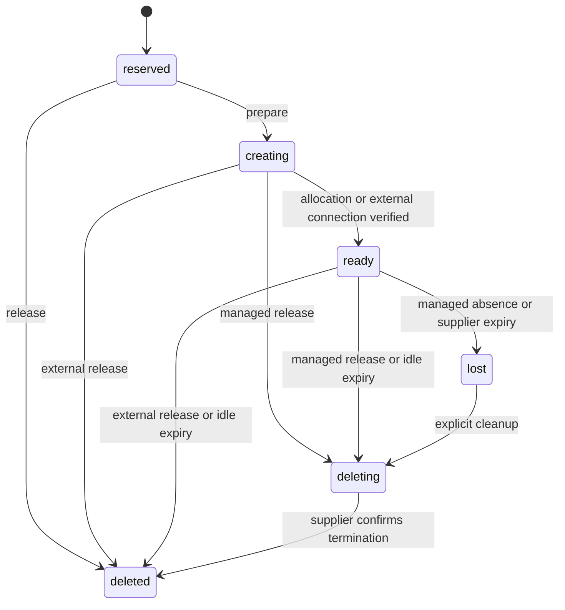
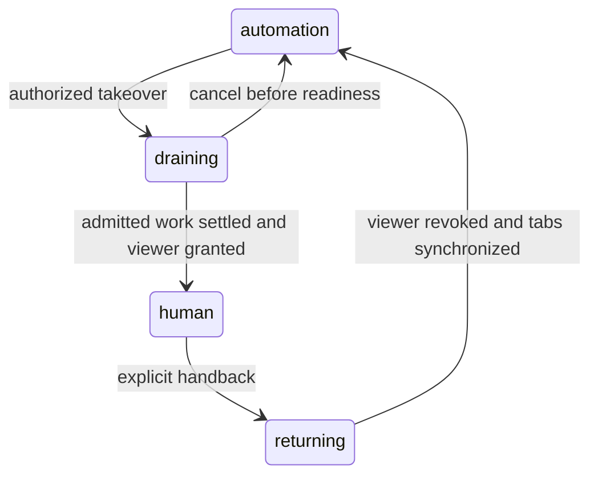

# Browsers

## Design position

A Browser is a workspace resource whose live session can serve several Threads and outlive their Runs. Service owns registration or allocation intent, authorization, durable target ownership, logical selection, human control and reconciliation. A Browser has source `managed` or `external_cdp`. A Browser Provider owns a managed source's supplier lifecycle and viewer access. An external source attaches an existing instance whose process and session lifecycle remain with its owner. [Harness Browser Use](../a13n-harness/23-browser-use.md) owns CDP execution, native tools and compact references. Browser resources are independent of Environment instances and Computer Use.

A provider account, reserved Browser identity, live supplier allocation, borrowed CDP connection and viewer grant have separate lifetimes. The API reports readiness explicitly. Metadata reads and desired bindings allocate nothing.

## Resource and binding

A Browser stores its workspace, source, nullable provider, creation recipe, backend identity, lifecycle status, generation, control episode and retention policy. Managed sources require a provider; external sources have no provider account. Supplier handles, external connection material and viewer data are encrypted and excluded from ordinary resource representations. Public reads expose source, nullable provider ID, status, control, generation, episode, supplier expiry and a classified failure code.

A Thread has at most one desired Browser binding:

| Field         | Meaning                              |
| ------------- | ------------------------------------ |
| `browser_id`  | Same-workspace Browser resource      |
| `tab_access`  | `thread` (default) or `global`       |
| `preparation` | `first_use` (default) or `run_start` |

[Run acceptance](05-runs.md) freezes the binding alongside the execution authority ceiling. Editing or detaching the desired binding affects future Runs; an accepted Run does not silently switch Browsers. A handback continuation uses the originating Run's binding and authority. Child and forked Threads have no implicit Browser binding; callers bind them explicitly. This avoids silently widening a child's target visibility or transferring a parent's tab ownership.

The Browser's lifetime is independent of its borrowers. Run exit and binding detachment disconnect borrowed clients without closing tabs or terminating the supplier allocation. Profile save/load and automatic replacement are not exposed by this contract. Releasing a managed live session does not preserve its DOM, tabs or login state as a resumable profile. Releasing an external attachment only unregisters Service access.

## External CDP attachment

`POST /browsers/attach` registers one existing instance under workspace `run` authority. It accepts `name`, secret `cdp_url`, optional secret `headers`, `prepare` (default false) and `idle_seconds` (default null). Registration, metadata reads and lazy binding open no connection. The protected handle contains the complete URL and headers, including secret query parameters, until release.

The caller supplies a direct browser-level WS(S) endpoint for one stable existing instance. HTTP discovery and endpoint changes are unavailable. Different instances require new Browser identities and explicit rebinding. A gateway's transparent replacement is not a continuity guarantee. Exact target IDs, never URL or title matches, determine ownership and selection.

Preparation validates browser-level connectivity using the same fenced lifecycle claims as managed preparation; it allocates nothing. Deployment destination policy applies at registration and every connection. WS maps to HTTP and WSS to HTTPS for policy checks, with the existing explicit insecure-origin exception. The full secret URL stays separate from the policy destination; this does not relax sensitive-query rejection for other endpoints. Handshakes are bounded and redirects are refused before forwarding secrets. Worker connections additionally apply frozen Run configuration, accepted authority and current grants. Loopback addresses refer to the connecting Service process's network environment.

Transport failure records `browser_connection_failed` without claiming the external instance is lost. A later connection may retry the immutable endpoint, reconstruct exact identities and invalidate references. No action is replayed and no replacement is allocated. External users and independently authorized clients remain outside Service's control.

External sources support the same global and Thread tab access. Existing pages start unowned; Thread ownership comes only from newly created tabs and their owned popups. Run exit, detachment, release and idle expiry never terminate the external process or automatically close its tabs. Explicit authorized tab-close tools keep their ordinary meaning. Release uses the existing borrower, unsettled-operation, claim and precondition checks and clears encrypted connection material, including release before preparation. External viewer, takeover and handback requests fail with `browser_viewer_unsupported` before changing control state.

## Preparation and retention

Creation reserves an identity by default. `prepare: true`, explicit `prepare`, `run_start`, first authorized native browser use and takeover converge on one lifecycle. Native tool admission and paid-call checks precede first-use allocation. Enabling the browser toolset or constructing a Run backend does not allocate.

The `deleting` and confirmed-loss paths apply to managed sources; external release directly forgets the attachment after the same safety checks. A claim records durable intent before supplier or external connection I/O and fences publication afterward. No database transaction spans supplier calls. Concurrent preparation converges on the original allocation identity. After uncertain create, reconciliation inspects that identity; absence does not authorize a second create. A previously confirmed allocation that disappears becomes `lost`; an inspection error preserves the last confirmed status and reports failure. Successful inspection refreshes the protected handle and supplier expiry without extending idle activity.

`idle_seconds` defaults to 1800 for managed creation and null for external attachment, accepts 60–604800 seconds, and accepts null for explicit-release retention. Retention is independent of preparation. Idle release requires no active accepted/running borrower, unsettled browser execution, human-control transition or unexpired handback obligation. A normally completed Run's blocked registration can retain the Browser until delivery and consumption, suppression or expiry. Unconsumed, still-valid inbox notifications retain it too. Obligations expire rather than retaining a billable resource forever. Supplier expiry takes precedence over local retention and invalidates outstanding availability notices.

Release requires workspace `write` and the Browser's current `If-Match`. Live use or an active lifecycle claim refuses release. A lost Browser permits explicit supplier cleanup even when old operations remain unknown. Deleting a reserved identity needs no supplier allocation. Deleted and lost resources never silently restart; a caller creates and binds a new Browser.

## Tab access and ownership

Both access modes share one browser profile, cookies and login state. Thread mode restricts native browser-tool targets, not account identity or the human viewer's visibility.

- Global access sees the actual live inventory, including unowned and other Threads' pages. Visibility does not acquire cleanup ownership.
- Thread access sees exact targets owned by that Thread and popups following their opener ancestry. Reads, actions, screenshots, dialogs and file operations use the same target boundary.
- Every newly created tab records its originating Thread. During human control, exact newly observed targets without an existing owner belong to the controlling Thread; control transfer does not reassign existing tabs.
- Ownership and selection are scoped to the Browser generation. Reconnection never matches a URL, title or window to infer identity.
- Each Thread keeps a logical selected target independently of native focus. If that exact target disappears, its selection clears; the next operation requires explicit selection or creation, without falling back to another tab.
- Native groups describe browser metadata, not Service ownership groups. Explicit authorized close is distinct from automatic lifecycle cleanup.

Worker attempts reconstruct scoped Harness backends from durable ownership and selection. Calls on the same page exclude each other, while unrelated pages may progress concurrently. Each admission advances an observation epoch; another client or handback invalidates actionable references. Mutations require fresh observation after invalidation. CDP clients, Page objects and compact references remain process-local and are not checkpoint authority.

## Human control

Control is Browser-wide and gates every browser tool, including reads and waits. Model work, non-browser tools and other Browsers continue. Independently authorized shell/CDP clients and external operators retain their own authority boundaries.

Takeover closes admission durably before waiting for already-admitted calls. Known completion settles an operation; worker loss, unknown protocol outcome or failure to persist ownership leaves it unsettled. Lease expiry alone never proves the browser action stopped. No viewer input grant is published while such operations remain unresolved.

A blocked call returns immediately, identifies that no browser action executed and registers its Thread for handback. Repeated blocks coalesce per Browser generation, episode and Thread while the registration remains active, retaining the originating execution provenance. A new actual blocked call after suppression or expiry creates a fresh registration identity and provenance; earlier queued hints cannot refer to that new obligation. Requesting takeover alone does not register a recipient. The Agent is directed to continue unrelated work or finish without polling.

Only the controlling principal obtains the sensitive viewer URL. Viewer expiry, provider disablement or lost controller authority triggers revocation, while control stays human until explicit handback. Revocation failure remains visible and keeps automation blocked. An authorized caller can hand back even when the controlling Thread is idle or has no tabs. Before readiness, handback cancels control intent without fabricating a browser-available event or replacing the allocation claim.

Handback first revokes every input connection for the grant, then synchronizes exact tab ownership and valid selections, invalidates references, and reopens automation. It stages recipient outbox intents in that transition's transaction. A later takeover advances the episode and suppresses unincorporated notices from earlier episodes.

## Handback input and durable observation

`browser_handback` is a typed internal inbox entry and outbox kind. Its payload names the registration, Browser, generation and episode. It is neither a user message, tool result nor approval answer. [Inbox and acceptance](05-runs.md) own capacity, ordering, assignment and continuation; the [outbox](07-facts-and-delivery.md#outbox) owns claims, retry and settlement. Mailbox remains an availability hint; handback adds no poller and no immediate-preemption category.

Delivery locks the recipient Thread and Browser, checks current generation, episode, binding, expiry, suppression and originating authority, and appends at most one entry in the same transaction as successful outbox settlement. A full inbox defers delivery. Post-commit advance is a hint; the existing advance sweep repairs lost wakeups. Each recipient uses its own originating authority ceiling plus current grants, never the controller's credentials or a wider active Run ceiling.

Active Runs incorporate compatible handback input at existing execution boundaries. Eligible idle Threads continue through ordinary acceptance. Approval/deferred waits remain waiting; failed and cancelled Runs retain explicit-continuation rules. Explicit stop, archive and binding replacement suppress applicable registrations; later unrelated input cannot revive them. Browser loss and expiry invalidate them without a successful-handback projection. Blocked or uncertain actions are never replayed automatically.

Acceptance and input reading revalidate notice eligibility. Durable incorporation additionally serializes with retake in the checkpoint transaction. Before a notice can enter any model request, including a compaction summary, the Service commits that observation through its existing checkpoint writer. A retake that wins first rejects the notice; a retake after incorporation leaves a historical observation, while every browser operation still checks the live gate.

Rejecting a notice preserves the same checkpoint cut's completed tools, inline child state and other valid inputs. Only the rejected input and its replay identity are removed, then the live attempt ends and ordinary recovery restores the corrected cut. A notification-only continuation with an obsolete source completes without a model request and without pausing its Thread. The ordinary post-projection/model boundary remains responsible for compaction and context-recovery checkpoints.

## Provider contract

A deployment registers trusted Browser Provider definitions under kind `browser`. Each supplies account/credential schemas, a creation recipe schema, backend identity and a factory. `supports_viewer` defaults to false. The built-in distribution has no live Browser supplier; registered types are the deployment's inventory.

| Operation                        | Required meaning                                                         |
| -------------------------------- | ------------------------------------------------------------------------ |
| `create(allocation_id, recipe)`  | Create under the stable Service allocation identity                      |
| `inspect(allocation_id, state)`  | Find that allocation without creating, restarting or replacing it        |
| `delete(allocation_id, state)`   | Idempotently confirm termination, including uncertain creation           |
| `connect(state)`                 | Borrow a browser-level Chromium CDP connection; closing disconnects only |
| `grant_viewer(state, grant_id)`  | Idempotently grant input under the exact durable grant identity          |
| `revoke_viewer(state, grant_id)` | Revoke existing and pending input connections under that identity        |

Successful deletion fences late creation under the allocation identity. Successful revocation fences late grants under the grant identity. An adapter must establish those guarantees before advertising support; hiding a viewer button or merely rejecting new connections is insufficient. Errors distinguish not-dispatched, known and unknown outcomes and expose only classified codes. Protected state contains supplier connection details, never public metadata or model input.

Credential rotation retains backend identity. Backend/account identity changes fail closed for existing Browsers, including cleanup; restoring the original account configuration is required to manage the original allocation. Disabled accounts refuse new use while retaining authorized cleanup. Native browser file paths refer to the supplier host. Download inspection follows the same tab scope; upload currently refuses because no authorized provider transfer boundary is exposed. Browser and Environment filesystems are independent.

## API and runtime

All paths below are relative to `/api/v1` and use [API scope and preconditions](10-api.md).

| Operation                             | Authority and result                                                          |
| ------------------------------------- | ----------------------------------------------------------------------------- |
| `POST /browsers`                      | Workspace `run`; reserve managed identity, optionally prepare                 |
| `POST /browsers/attach`               | Workspace `run`; register external CDP identity, optionally verify            |
| `GET /browsers`, `GET /browsers/{id}` | Workspace `read`; metadata only, no allocation; list omits deleted rows       |
| `POST /browsers/{id}/prepare`         | Workspace `run`; converge on readiness                                        |
| `POST /browsers/{id}/release`         | Workspace `write`, Browser `If-Match`; borrower-safe release                  |
| `GET /threads/{id}/browser`           | Workspace `read`; desired binding or null                                     |
| `PUT /threads/{id}/browser`           | Workspace `run`, Thread `If-Match`; set binding or detach with null           |
| `POST /browsers/{id}/takeover`        | Authorized browser control, Browser `If-Match`; body names controlling Thread |
| `POST /browsers/{id}/handback`        | Authorized browser control, Browser `If-Match`; explicit transition           |
| `POST /browsers/{id}/viewer`          | Authorized controller; sensitive URL, expiry and episode with `no-store`      |

Metadata and lifecycle management routes have explicit external MCP admission. Takeover, handback and viewer access remain direct HTTP control operations. Browser resources have no internal platform-operation admission. Provider accounts use the existing resource CRUD and credential rules under `/browser-providers`.

The control role reconciles bounded rotating batches for lifecycle, idle expiry, viewer revocation and control completion. Worker attempts borrow native clients; retained tool ownership keeps resources alive through late invocation completion. Existing outbox delivery and Thread advancement own notifications. No additional browser execution queue or Agent loop exists.

## Compatibility

The schema change adds Browser provider/resource, binding, target ownership, selection, operation and blocked-registration tables, nullable frozen Run selection, and the new internal trigger/inbox/outbox kind. Existing Browser rows receive source `managed`; provider IDs become nullable only for external sources. Older workers cannot execute external sources, so the source extension requires coordinated control and worker rollout before attachment is enabled. Old Runs without a binding remain browser-free. Deployments update control and worker code together before enabling browser workloads; older readers cannot interpret the new closed-enum values. Application rollback or forward repair is preferred once Browser facts exist; schema downgrade refuses to erase those facts.
